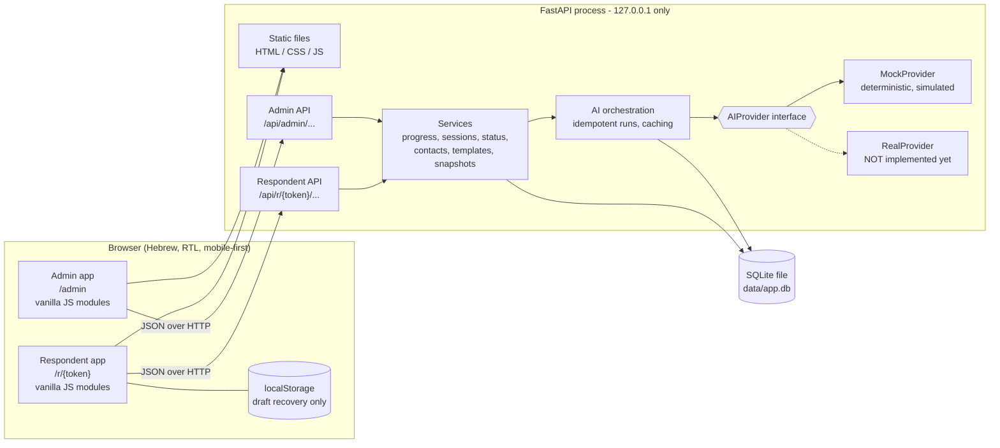
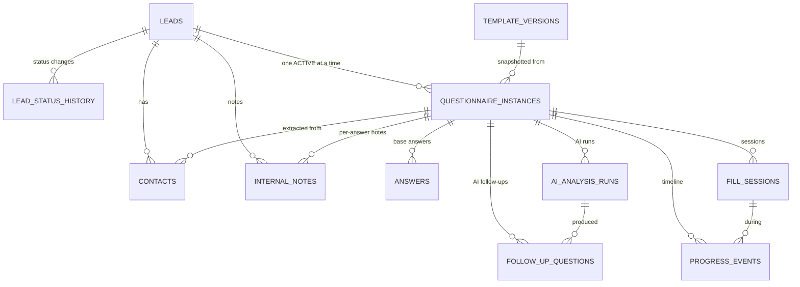
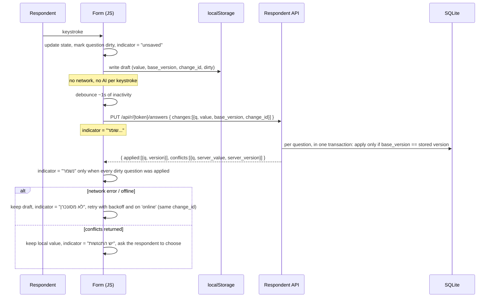

# AI Client Discovery - Architecture

Status: **Approved for local assignment MVP** (v0.2). Covers Lesson 9 phases **Design** and **Place**. **No deployment** is planned or performed in this assignment.

Approved decisions in force: Python + FastAPI + SQLite + HTML/CSS/vanilla JS (no Node.js, no React); private GitHub repository; no admin authentication in the local-only MVP (synthetic data only; authentication mandatory before deployment, section 9.3); deterministic mock AI first, real AI and real-model Evals only after explicit approval; auto follow-ups (max 5) after the base questionnaire; one automatic analysis run after final submission, no duplicates, admin retry only on failure; configurable contact groups; date-picker questions; locally bundled open-licensed Hebrew font; all approved product features in scope; automated Tests, simulated Evals and responsive checks inside the assignment milestones.

Related documents: `SPEC.md` (what to build), `practice.md` (how we work). Where this file makes a decision that refines SPEC.md, it is recorded in the Decision Log (section 12).

Conventions: documentation is English; all end-user UI text is Hebrew, RTL. Status labels, the questionnaire title pattern and the 18 original questions are taken verbatim from SPEC.md and are not repeated here.

---

## 1. Goals and constraints

| Constraint | Source | Consequence |
|---|---|---|
| Python, FastAPI, SQLite, HTML, CSS, vanilla JavaScript. No Node.js, React or frontend frameworks | Owner decision 1 | No build step; static files served by FastAPI; browser ES modules |
| Local only, bound to localhost, synthetic data only | Owner decision 3 | No admin authentication in the MVP; strong guards against accidental exposure (section 9) |
| Mock AI first, real provider pluggable later | Owner decisions 6, 7, 10 | `AIProvider` interface; every AI output carries `provider` and `is_simulated` |
| No paid services, no external AI calls, no deployment | SPEC section 7, practice section 5 | CI and tests are network-independent and need no secrets |
| Mobile-first, Hebrew RTL, approved palette | SPEC section 8 | CSS built from narrow widths up, logical properties, design tokens |
| Small scale: 1-5 staff, tens of leads | SPEC section 1 | One process, one SQLite file, no queue, no cache server |

---

## 2. Component overview



Key boundaries:

- **Two separate API surfaces.** `/api/r/{token}/...` (respondent) and `/api/admin/...` (internal). They use **separate response schemas**; respondent responses are built from an explicit allow-list of fields, never from raw database rows. This is what keeps internal notes, AI analysis and follow-up rationales out of the respondent path.
- **AI is behind one interface.** Services call the orchestration layer, never a provider directly. Swapping providers is a configuration change plus one new class.
- **The browser is a client, not a source of truth.** `localStorage` is a recovery aid only.

### 2.1 Repository state and proposed layout

**Current state:** the private GitHub repository `stavdayan-netizen/ai-client-discovery` exists and `main` contains the initial planning commit (`5290bd5`): `SPEC.md`, `practice.md`, `architecture.md`, `CLAUDE.md`, `README.md`, `.gitignore`. The private GitHub Project board (To do / In progress / Done) has been created and linked to the repository. The nine approved Issues (section 14) exist as GitHub Issues #1 to #9 and are tracked in Project #1. No collaborators have been invited. Documentation and management files (`.env.example`, Issue and PR templates) are added by Issue #1; everything else below is **proposed and not yet created**, and each piece is created through its own Issue, branch and Pull Request.

Proposed layout (files already present are marked):

```
SPEC.md  practice.md  architecture.md  README.md  .gitignore  CLAUDE.md   # already on main
.env.example                                                              # added by Issue #1 (names only)
.github/ISSUE_TEMPLATE/task.md  .github/pull_request_template.md           # added by Issue #1
app/
  main.py              # app factory, middleware, static mounting
  run.py  __main__.py  # guarded launcher: python -m app
  network.py           # localhost-only protections, security headers
  config.py            # env-driven settings (+ optional .env)
  db.py                # sqlite3 connection, transactions, migration runner
  seed.py  seed_data/  # template v1 and fictional demo leads
  migrations/          # numbered .sql files (0001_init.sql, ...)
  api/                 # admin_*.py, respondent.py (thin routers)
  schemas/             # pydantic models: admin_out.py, respondent_out.py, ...
  services/            # progress.py, sessions.py, status.py, contacts.py,
                       # templates.py, instances.py, autosave.py
  ai/                  # base.py, mock.py, registry.py, orchestration.py, prompts/
  static/
    admin/  respondent/  shared/
    css/tokens.css base.css ...
    js/                # ES modules
tests/                 # pytest: unit, API, e2e/responsive
evals/
  cases/               # synthetic Hebrew questionnaire cases (JSON)
  run_evals.py
  reports/             # labelled results (simulated vs real)
.github/
  workflows/ci.yml
  ISSUE_TEMPLATE/  pull_request_template.md
```

Dependencies (all free): `fastapi`, `uvicorn`, `pydantic`, `httpx` (test client), `pytest`, `playwright` (Python; downloads a free Chromium for responsive tests). No ORM: plain `sqlite3` with SQL migrations, to keep the learning surface small and the schema visible.

---

## 3. Data model

### 3.1 Entity relationships



There is no `users` table in the MVP (no authentication). Notes store a fixed `author_label` (`"Demo admin"`) so that adding real users later is a column migration, not a redesign.

### 3.2 Tables

All timestamps are stored as UTC ISO-8601 text and displayed in `Asia/Jerusalem`. All IDs are opaque text (ULID/UUID); question IDs are described in 3.3.

| Table | Key columns and rules |
|---|---|
| `leads` | `id`, `company_name`, `contact_name?`, `email`, `phone`, `status` (one of the 5 Hebrew statuses), `created_at`, `updated_at`. All demo rows flagged fictional in seed data. |
| `lead_status_history` | `lead_id`, `from_status`, `to_status`, `changed_at`, `changed_by`, `reason?`. Append-only. |
| `template_versions` | `id`, `version_number` (unique), `state` (`draft` / `published`), `intro_text`, `title_pattern`, `definition` (JSON, see 3.3), `created_at`, `published_at?`. Version 1 is seeded from SPEC section 5 and never modified. At most one `draft` row at a time. Published rows are immutable. |
| `questionnaire_instances` | `id`, `lead_id`, `template_version_id`, `definition_snapshot` (JSON copy), `state` (`active` / `void`), `phase` (`base` / `followups` / `submitted`), `token_hash`, `link_revoked_at?`, `link_expires_at?`, `sent_at?`, `first_opened_at?`, `first_answer_at?`, `last_activity_at?`, `base_completed_at?`, `submitted_at?`, `created_at`. **Partial unique index on `(lead_id) WHERE state = 'active'`** enforces one active questionnaire per lead. |
| `answers` | `instance_id`, `question_id`, `value` (JSON: string, date string, or list of person objects; NULL when `marked_unknown` is set), `marked_unknown` (0/1; allowed only for `date` and `person_group` questions, enforced by the service from the snapshot; DB `CHECK (marked_unknown = 0 OR value IS NULL)`; see 3.4), `version` (int, server-assigned, +1 per applied write), `last_change_id`, `updated_at`. `UNIQUE(instance_id, question_id)`. One current row per question; the history is the progress timeline, not a keystroke log. |
| `follow_up_questions` | `id`, `instance_id`, `ai_run_id`, `ordinal`, `text` (Hebrew), `rationale` (internal), `source_question_ids` (JSON), `status` (`pending` / `answered` / `skipped`), `answer_text?`, `answered_at?`. CHECK ordinal between 1 and 5. |
| `fill_sessions` | `id`, `instance_id`, `started_at`, `last_heartbeat_at`, `ended_at?`, `end_reason` (`explicit_save` / `idle` / `hidden` / `submitted` / `unknown`), `active_seconds`. |
| `progress_events` | `id`, `instance_id`, `session_id?`, `type` (`opened`, `first_answer`, `progress_changed`, `paused`, `resumed`, `draft_saved`, `base_completed`, `followups_shown`, `submitted`, `link_revoked`, ...), `completion_pct`, `at`, `meta` (JSON). Written only at meaningful milestones (progress crosses a 10-point step, section completed, etc.), never per keystroke. |
| `contacts` | `id`, `lead_id`, `name`, `role?`, `responsibility?`, `phone?`, `email?`, `origin` (`extracted` / `manual`), `is_sponsor`, `source_instance_id?`, `source_question_id?`, `dedupe_key`, `created_at`, `updated_at`, `removed_at?`. See 5.5. |
| `internal_notes` | `id`, `lead_id`, `instance_id?`, `question_id?` (null = general lead note), `follow_up_id?`, `author_label`, `body`, `created_at`. **Append-only** in the MVP: no edit, no delete. Many rows per question. |
| `ai_analysis_runs` | `id`, `instance_id`, `kind` (`follow_ups` / `analysis`), `provider`, `model?`, `is_simulated` (bool), `prompt_version`, `input_hash`, `status` (`pending` / `succeeded` / `failed`), `output` (JSON), `error?` (for example `provider_error`, `invalid_output`, `interrupted`), `created_at`, `lease_expires_at` (set when a `pending` row is created: now + provider timeout + margin, planned 60 s), `completed_at?`. **Partial unique index on `(instance_id, kind) WHERE status IN ('pending','succeeded')`** guarantees at most one live or successful run per kind. **Recovery of interrupted runs:** see 4.3. |

Rules that hold across tables:

- Original answers are never rewritten by AI output, by contact edits, or by template edits.
- Verbatim client text (`answers`, `follow_up_questions.answer_text`), AI output (`ai_analysis_runs.output`) and team text (`internal_notes`) live in separate tables, which makes the three-way separation required by SPEC section 4 structural rather than a display convention.

### 3.3 Template definition JSON

```jsonc
{
  "sections": [
    {
      "id": "sec_<stable>",
      "title": "חלק א': ...",
      "active": true,
      "questions": [
        {
          "id": "q_<stable>",              // generated once, never reused, never changed
          "type": "long_text",             // long_text | short_text | date | person_group
          "label": "מהו האתגר המרכזי ...",
          "required": true,                // template v1: true for all 18 questions
          "active": true,                  // archive instead of delete
          "tag": null,                     // semantic tag, see below
          "config": {}                     // type-specific
        }
      ]
    }
  ]
}
```

- **Supported types:** `long_text`, `short_text`, `date` (native `<input type="date">` calendar picker; free, no library, localized by the browser), `person_group`.
- **`person_group` config:** `{ "fields": ["name","role","responsibility","phone","email"], "required_fields": ["name"], "min": 0, "max": 20 }`. Each question chooses which sub-fields appear. Question 5 of v1 uses `name, role, responsibility`; question 6 (sponsor) uses `name, role` with `max: 1`. Phone and email are optional sub-fields available to any group. *(See decision D-12: this reconciles owner decision 5 with the SPEC question 5 wording.)*
- **Semantic tags:** `stakeholders`, `sponsor`, `end_users`, and `null`. Contact extraction reads tags, never question numbers, so reordering or rewording cannot break it. A tag may appear on at most one active question per template version (validated at publish).
- **Stable IDs:** the editor generates IDs; the admin cannot type or edit them. Reorder changes only array position. "Remove" sets `active: false` for questions that already have answers anywhere, and the editor hides inactive questions from new instances only. Brand-new unpublished questions in a draft may be hard-deleted from the draft.
- **Numbering** shown to the respondent is computed from position in the snapshot, not stored.
- **Required flag.** In template v1 **all 18 original questions are `required: true`**. The flag stays configurable per question in the template editor for future versions; newly added questions default to required (the admin can switch them to optional). A published version needs at least one active required question (4.7).
- **The unknown option is type-based, not a setting.** Only `date` and `person_group` questions offer "לא ידוע / טרם הוחלט" (3.4); `long_text` and `short_text` questions are free-text only, with no predefined options. The template editor has no switch for it.

### 3.4 Free text, and the unknown marker for date and contact-group questions

- **Text questions (`long_text`, `short_text`) are free-text only**, with no predefined options. Whatever the respondent types, including "לא יודע", "טרם הוחלט" or "לא רלוונטי", is an ordinary value. A non-empty (trimmed) value counts as an answer for progress and validation. The system does not parse typed text into any structured state; understanding such answers is the AI's job (section 6) and its interpretations are never written to `answers`.
- **Date and `person_group` questions** additionally offer the explicit option **"לא ידוע / טרם הוחלט"** (a toggle next to the date picker or the contact group, at least 44px touch target, with a text label). Selecting it satisfies the required-field validation and counts toward completion.
- **Stored distinctly:** the selection sets `marked_unknown = 1` with `value` NULL, so it can never be mistaken for a real date or contact list, and differs from an untouched or cleared question (`marked_unknown = 0` and no value). Selecting the option replaces any entered value; entering a date or contact again clears the marker.
- The admin view shows a labeled marker ("לא ידוע / טרם הוחלט") instead of a date or contacts. Internal notes can be attached to it like to any answer.
- **Distinct from "skipped".** Skipping exists only for follow-up questions (`follow_up_questions.status = 'skipped'`); a base question is either answered, marked unknown (date and contact groups only) or incomplete.
- A marker change is an ordinary autosave change (`value` and `marked_unknown` together), versioned and conflict-checked like any other (4.2).
- This is the only structured "unknown" in the data model. There is no `not_applicable` value and no per-answer state enumeration.

---

## 4. Key flows

### 4.1 Lead creation, questionnaire instance, and link

```mermaid
sequenceDiagram
  actor Admin
  participant UI as Admin app
  participant API as Admin API
  participant DB as SQLite

  Admin->>UI: Create lead (company, email, phone)
  UI->>API: POST /api/admin/leads
  API->>DB: insert lead (status חדש) + status history
  Admin->>UI: Create questionnaire
  UI->>API: POST /api/admin/leads/{id}/instances
  API->>DB: copy latest PUBLISHED template into definition_snapshot
  API->>DB: insert instance (state active, token_hash)
  API-->>UI: link shown ONCE (raw token is never stored)
  Admin->>UI: Copy link, send it outside the app
  Admin->>UI: Mark as sent
  UI->>API: POST /api/admin/instances/{id}/mark-sent
  API->>DB: sent_at = now; status חדש to ממתין למילוי; history row
```

- The system **never sends email**. "Mark as sent" only records a timestamp the admin asserts (SPEC section 2 step 3).
- Only the **hash** of the token is stored. The raw link is displayed at creation or regeneration. If lost, the admin revokes and regenerates (rotation). This is a deliberate small-security / small-convenience trade-off.
- Creating a second instance while one is `active` is rejected; the admin may void the active one first (void keeps all its data).

### 4.2 Autosave (the most failure-prone path)



**Ordering and conflict rules (documented behavior):**

The unit of conflict detection is **one question's answer** (for a contact group, the whole group). The server keeps a **server-assigned `version`** per answer (starts at 0 for "never saved", +1 on every applied write) and the `change_id` of the last applied write. The server never overwrites on a mismatch.

1. Every change the client sends carries `base_version` (the server version the edit was made on top of) and a random `change_id`. Both are kept in the `localStorage` draft until the write is acknowledged.
2. **Apply rule (server, atomic per question).** In order:
   1. `change_id` equals the stored `last_change_id`: this exact write was already applied (a retry after a lost response). Return success with the current version. **Idempotent retries.**
   2. `base_version` equals the stored `version`: apply, increment `version`, store `change_id`. Return the new version.
   3. `base_version` differs but the submitted `value` and `marked_unknown` are **identical** to the stored ones: two devices converged on the same answer (or the same marker). Return success with the current version; no write.
   4. Otherwise: **conflict.** Nothing is written. Return the server's current value and version.
3. Only one save request is in flight per form; edits made during a flight are batched into the next request. Within a single device this preserves order, and `base_version` additionally stops a delayed older request from overwriting newer data.
4. **Conflict resolution UI (no silent loss).** On a conflict the form keeps the respondent's text, marks that question with an inline notice, shows both versions (the respondent's and the saved one), and offers two buttons: keep mine (re-sent with `base_version` set to the server's current version) or keep the saved one (local text is replaced). Until every conflict is resolved the indicator shows "יש התנגשות" and never "נשמר", and "המשך לשליחה" is blocked. The respondent's text stays in the `localStorage` draft until the choice is made, so a refresh does not lose it.
5. **Picking up the other device's edits.** On load, and whenever the tab becomes visible again, the client fetches the current answers. For a question with no unsent local edits, the server value is adopted silently. For a question with unsent local edits whose `base_version` is older than the server's, the conflict flow in rule 4 is shown instead of overwriting either side.
6. "Saved" is shown only when the server acknowledged (applied, or equal) the latest local change of every dirty question.
7. "שמירת טיוטה ויציאה" flushes immediately and waits for the acknowledgment (or shows the conflict notice) before leaving. The draft is removed from `localStorage` after final submission.
8. **Accepted limitation:** there is no automatic text merge inside one answer, and two devices are not co-edited live. The cost is one explicit choice per conflicting question. Regression tests cover: older request after newer, duplicate/retried request, equal text from two devices, and conflicting text from two devices (neither side is lost).

### 4.3 Base questionnaire to follow-ups to final submission

```mermaid
sequenceDiagram
  actor Lead as Respondent
  participant API as Respondent API
  participant ORC as AI orchestration
  participant P as AIProvider (Mock)
  participant DB as SQLite

  Lead->>API: POST /continue  (המשך לשליחה)
  API->>DB: flush answers; validate ALL required answered (optional may be empty); phase = followups; base_completed_at
  API->>ORC: generate_follow_ups(instance)
  ORC->>DB: sweep expired pending runs; insert run(kind follow_ups, pending, lease) only if none exists for this kind
  ORC->>P: structured input (answers only)
  alt success
    P-->>ORC: 0-5 questions + rationale + source IDs
    ORC->>ORC: validate: max 5, no duplicates, source IDs exist, Hebrew text
    ORC->>DB: run succeeded; insert follow_up_questions
  else failure / timeout / invalid output
    ORC->>DB: run failed (error recorded)
    Note over Lead,API: respondent is NOT blocked; zero questions shown
  end
  API-->>Lead: follow-ups (text only; rationale and source IDs stripped)
  Lead->>API: answer or skip each (optional)
  Lead->>API: POST /submit  (שליחה סופית)
  API->>DB: single transaction: phase = submitted, submitted_at, status = התקבל, event, INSERT analysis run (pending, lease)
  API-->>Lead: confirmation; form is now read-only
  API->>ORC: start the already-created analysis run (background task)
  ORC->>P: analyze(submitted answers + follow-up answers)
  P-->>ORC: structured analysis
  ORC->>DB: UPDATE run SET succeeded, output WHERE id = ? AND status = 'pending'
```

Properties:

- **Idempotent submit.** The submit transaction checks `phase` first; a double click or retried request returns the existing result and creates nothing new. Same for `/continue` (the unique run index prevents a second follow-up run).
- **Follow-up generation is synchronous** with a short timeout (the mock returns instantly; a future real provider must meet the same budget or the failure path applies). Follow-ups are generated **once per instance**; going back to edit and continuing again reuses the stored run unless the admin voids and recreates the instance. *(Decision D-9.)*
- **Original progress never decreases**: follow-up answers are tracked separately (asked / answered / skipped) and excluded from the base completion percentage.
- **Follow-ups about unknowns.** The provider receives each base question with the respondent's text, or for date and contact-group questions the `marked_unknown` flag. Unknown information (marked on a date or contact group, or interpreted by the provider from free text) may produce an optional, skippable follow-up when the topic is important for the discovery call, within the 0-5 cap. A follow-up answer is stored separately and does not change the base answer or clear the marker.
- **Analysis runs once, automatically, after submit.** The `pending` analysis run is created **inside the submit transaction**, so a crash right after submission cannot leave a submitted questionnaire with no run record. Opening the analysis tab only reads `ai_analysis_runs.output`. If the latest run is `failed`, the admin sees "analysis unavailable" with an **explicit "retry" button**, which creates a new run row after confirmation. The button is not shown while a run is `pending` or `succeeded`. No other path calls the provider. *(Decision D-10.)*
- The analysis run state (`pending` / `succeeded` / `failed`) is shown in the admin UI, together with a visible **"simulated"** badge when `is_simulated` is true.
- **Recovery of runs stuck in `pending` (server stopped or crashed mid-run).** Every `pending` row has a `lease_expires_at`. A single **sweep** statement marks as `failed` (with `error = 'interrupted'`) every row where `status = 'pending' AND lease_expires_at < now`. The sweep runs (a) at application startup, (b) before the admin analysis tab or run status is read, and (c) before the orchestration layer decides whether to create a run. There is no background scheduler and no automatic re-run.
  - **Idempotency is preserved.** A swept run becomes `failed`, so it leaves the partial unique index, but new runs are created only by two code paths: the initial run (follow-ups: at `/continue`, only if **no** run of that kind exists at all; analysis: inside the submit transaction) and the admin retry (analysis only, only when the latest run is `failed`). A sweep therefore never causes a duplicate on its own.
  - **A late provider result cannot resurrect or duplicate a run.** Results are stored with `UPDATE ... WHERE id = ? AND status = 'pending'`; if the row was already swept to `failed`, zero rows change and the late result is discarded.
  - **Admin retry stays "after failure only".** An interrupted analysis is shown as failed ("interrupted") and gets the retry button; a run that is still within its lease shows as running, with no retry button.
  - **Follow-ups:** an interrupted follow-up run is swept to `failed` the next time the respondent loads or continues; the respondent proceeds with zero follow-up questions (the existing no-block rule). Follow-ups are not retried automatically or by the admin.

### 4.4 Activity, sessions and active time

- A **session** starts when the respondent page becomes visible and the form loads, and is closed when: the tab is hidden, the user saves and exits, final submission occurs, or **5 minutes pass without interaction** (key/touch/scroll/click), whichever comes first. A later return opens a **new session** (this is what "distinct filling sessions" counts).
- While visible and not idle, the page sends a heartbeat every 15 seconds. The **server** computes `active_seconds += min(now - last_heartbeat_at, 30s)`. Computing on the server, with a cap, prevents double counting from retries or multiple tabs (a second tab opens its own session, and overlapping intervals are the documented known approximation).
- Active time is therefore **approximate by design**, and the admin UI labels it as such.
- Tracked: timestamps, completion percentage at milestones, session start/end. **Not tracked:** keystroke content/timing, mouse movement, device fingerprints, IP addresses.

### 4.5 Progress percentage

`completion_pct = answered_required_questions / total_required_questions` over **active** questions, using the instance's **frozen snapshot** (never the live master template).

- A question counts as **complete** when it has an answer (next bullet) or, for `date` and `person_group` questions only, when it is marked unknown (3.4). Otherwise it is incomplete.
- A `long_text` or `short_text` question has an answer when its trimmed text is non-empty, whatever the content: "לא יודע" counts. A `date` question has an answer when a date is chosen. A `person_group` question has an answer when at least one row has all of that group's `required_fields` filled; one question counts once regardless of the number of rows.
- **Optional questions are not part of the percentage** (decision D-8, revised). They are reported separately as "optional complete / optional total" (for example, "3 of 7 optional answered"). Answering or leaving optional questions empty never raises or lowers the percentage. In template v1 every question is required, so the optional counter does not appear there; it appears only for later versions that mark questions optional.
- The admin also sees which date and contact-group questions are marked "לא ידוע / טרם הוחלט", so 100% is not mistaken for 18 concrete values. The respondent sees the percentage and the number of remaining questions.
- A template version must contain at least one active required question to be published (so the denominator is never zero).
- The respondent sees a progress bar for required questions plus the separate optional counter; the admin sees the percentage, the completed sections (a section counts as complete when all its required questions are answered) and the optional counter.

**What 100% means (and does not mean).** 100% means every active **required** question of the base questionnaire is complete: it has an answer, or (date and contact-group questions only) is marked "לא ידוע / טרם הוחלט". For template v1 that is all 18 questions. This is **questionnaire completion** (the base questionnaire is ready to continue), and it is the condition for "המשך לשליחה": the respondent may continue when, and only when, all required questions are complete, even if optional questions remain empty. Server-side validation at "המשך לשליחה" uses exactly the same rule; the client cannot bypass it. `base_completed_at` is set by that action, not by merely reaching 100%. Completion is **not submission**: at 100% the lead is still in `ממתין למילוי`, `submitted_at` is empty and the form is still editable. Only a successful final submission ("שליחה סופית") sets `submitted_at`, changes the status to `התקבל` and shows "נשלח". Follow-up questions never change the percentage.

Planned respondent UI reflecting this:
- The progress bar is labelled as required-question fill progress ("מילוי השאלון"), with a separate line for unanswered optional questions (for example "נשארו 4 שאלות רשות - אפשר להמשיך גם בלעדיהן"), and a separate **three-step indicator** showing the stage: מילוי השאלון, שאלות המשך, שליחה סופית. At 100% the bar does not say "נשלח" or "הושלם"; it shows a plain message that the required questions are complete and the questionnaire **has not been sent yet**, and the "המשך לשליחה" button becomes enabled and emphasized. Below 100% the button is disabled and a message lists which required questions remain (and, on date and contact-group questions, that "לא ידוע / טרם הוחלט" is a valid way to complete them).
- The text "נשלח" appears only after final submission succeeds and the form turns read-only.
- Admin dashboard and lead detail show the percentage together with the stage (filling, follow-ups, submitted), the optional counter, and the submission date only from `submitted_at`, so "100%" is never read as "received". Status `התקבל` is set only by final submission.

### 4.6 Contacts extraction

On final submission, a service reads the snapshot for questions tagged `stakeholders` and `sponsor` and creates `contacts` rows. Only contact groups with entered rows are read; a group marked "לא ידוע / טרם הוחלט" or left empty creates no contact and nothing is inferred (a sponsor group marked unknown simply produces no sponsor contact, and the analysis lists it as an unknown):

- `dedupe_key = normalize(name) + "|" + normalize(email or "")` where normalize lowercases, trims and collapses whitespace.
- If a row with the same `lead_id` and `dedupe_key` exists (extracted or manual), it is **not duplicated**; if the same person appears as stakeholder and sponsor, the existing row gets `is_sponsor = true`.
- Extraction stores provenance (`source_instance_id`, `source_question_id`) and `origin = 'extracted'`. Manual contacts have `origin = 'manual'`.
- Admin edits and removals (soft-delete via `removed_at`) change only `contacts`. They never touch `answers`.
- A soft-deleted extracted contact is **not re-created** by a later extraction (the dedupe key still matches).

### 4.7 Template editing and versioning

- The admin edits a single `draft` row: add/remove/edit/reorder sections and questions, change type, required flag, tag, and person-group fields. Reorder uses **up/down buttons** (works on touch and keyboard; no drag-and-drop dependency).
- **Preview** renders the draft through the same respondent renderer in a read-only mode.
- **Publish** validates (unique tags, at least one active **required** question, stable IDs intact, no type change on a question ID that already has answers in any instance) and writes a new immutable `version_number`. Existing instances keep their snapshots; only new instances use the new version.
- Version 1 is the seeded original and cannot be modified.

### 4.8 Status model

`חדש` to `ממתין למילוי` (on mark-sent) to `התקבל` (automatic on final submission) to `בבדיקה` to `הושלם`.

- The admin may move **forward one step** (only `התקבל` onward, since `ממתין למילוי` to `התקבל` is reserved for the system) or **back one step** with a mandatory reason. Every change writes `lead_status_history`.
- Draft activity is **not a status**; it is derived from sessions and answers: not started / started / saved and left / resumed, plus last saved time.

---

## 5. API surface (sketch)

Respondent (`/api/r/{token}`; token resolved by hash; unknown, revoked or expired all return the same 404):

| Method | Path | Purpose |
|---|---|---|
| GET | `/` | Heading, intro, questions, own answers, phase, follow-ups (allow-listed fields) |
| PUT | `/answers` | Batched autosave with `base_version` / `change_id`; returns applied and conflicts (4.2) |
| POST | `/activity` | Heartbeat / session events |
| POST | `/save-draft` | Flush and close session |
| POST | `/continue` | Validate, generate follow-ups |
| PUT | `/follow-ups/{id}` | Answer or skip |
| POST | `/submit` | Final submission |

Writes to a submitted instance return 409 (read-only). Admin (`/api/admin/...`): leads CRUD, instances (create, mark-sent, revoke, regenerate, void), instance detail with progress, sessions and timeline, notes (list/add per answer or per lead), contacts CRUD, status change, AI run view and retry, template draft CRUD / reorder / preview / publish.

---

## 6. AI component

### 6.1 Provider interface

```python
class AIProvider(Protocol):
    name: str            # "mock" | future "anthropic", ...
    model: str | None
    is_simulated: bool   # True for MockProvider, always

    def generate_follow_ups(self, request: FollowUpRequest) -> FollowUpResult: ...
    def analyze(self, request: AnalysisRequest) -> AnalysisResult: ...
```

Requests carry every base question as `{question_id, label, type, value?, marked_unknown}`, so a provider sees the respondent's own words and, for date and contact-group questions, whether they were marked unknown. Requests and results are Pydantic models. A provider returns **structured data only**; the orchestration layer validates it (counts, ID existence, schema) before anything is stored, so a real model's mistakes cannot corrupt the database. Provider selection is `AI_PROVIDER=mock` (default) in the environment, resolved in `ai/registry.py`.

### 6.2 What is stored with each result

Every `ai_analysis_runs` row records `provider`, `model`, `is_simulated`, `prompt_version`, `input_hash`, status and timestamps. The admin UI renders a visible label (for example **"סימולציה - לא תוצאת מודל אמיתי"**) whenever `is_simulated` is true. Eval reports carry the same field in their header (section 10).

### 6.3 MockProvider (deterministic, rule-based)

- **Follow-ups:** a fixed Hebrew question bank keyed by question ID and gap type. Gap rules examples: a date or contact group marked "לא ידוע / טרם הוחלט"; free text containing a phrase from a fixed list of Hebrew unknown/undecided phrases (for example "לא יודע", "לא יודעת", "טרם הוחלט", "עדיין לא החלטנו") on a topic from the fixed "important unknowns" list (success measures, project sponsor, data location, sensitive data, human approval, budget); text shorter than a word threshold; no number or measure in the KPI question. Free text matching a fixed list of not-applicable phrases (for example "לא רלוונטי") is never asked about. This phrase matching is a crude, deterministic stand-in for interpretation, is limited to what its lists contain, and is never stored as an answer state. Contradiction detection between answers is *not* attempted. Output is ordered by a fixed priority, capped at 5 (so lower-priority unknowns are simply not asked), and skips any bank question whose source answer is adequate. Follow-up wording invites rather than presses ("אם כבר יש לכם מידע על ..."). Zero questions is a normal result. No question asks for secrets or personal data.
- **Analysis:** fills the SPEC section 7 headings (business need, current workflow, outcomes/KPIs, stakeholders and systems, data and security considerations, unknowns, suggested next-call questions, tentative directions) by quoting submitted answers verbatim with source question IDs, and emitting directions only as labeled hypotheses from a small rule table. It keeps three groups apart: **(1) stated information**, quoted verbatim with source IDs; **(2) unknown or undecided information**: date and contact questions marked "לא ידוע / טרם הוחלט" (a recorded fact) and free-text answers the provider *interprets* as unknown (an **AI interpretation**, shown with the quoted text and source ID and labeled as an interpretation, never presented as something the respondent selected), listed under "unknowns" as open items for the next call; **(3) information interpreted as not applicable** (also a labeled interpretation; reported as such, not as a gap or risk). Interpretations are stored only in `ai_analysis_runs.output`, never in `answers`. The provider never fills in, guesses or implies a value for an unknown item, and never states budgets, API availability, KPIs or commitments the respondent did not provide.
- Same input produces the same output (no randomness, no clock inside the output), which is what makes it usable for exact test assertions.

The mock proves the **plumbing and safety rules**, not language quality. It must never be described as evidence of model quality.

### 6.4 Connecting a real provider later (not part of this assignment)

Adding a provider means: one new class implementing the interface, one registry entry, a documented prompt version, and an approved key in a local `.env`. Before any real call: owner approval of provider, model, budget cap, and a data-handling statement. In the MVP no real client data exists, only synthetic cases; sending real client answers to an external provider is a separate decision (privacy, consent, terms).

---

## 7. Frontend architecture

- **Static HTML shells** (`/admin/...`, `/r/{token}`), each loading ES modules. No framework, no bundler, no CDN. `<html lang="he" dir="rtl">`.
- **Small module set:** `api.js` (fetch wrapper), `state.js` (tiny store), `autosave.js` (the state machine in 4.2), `activity.js` (heartbeat/idle), `render/*.js` (DOM builders using `textContent`, never `innerHTML` with user data), `i18n-he.js` (all UI strings), `format.js` (dates, LTR islands).
- **Design tokens** in `tokens.css`: the five palette colors and three soft backgrounds from SPEC section 8, spacing, radius, focus ring. Mobile-first CSS: base styles target ~320px; `@media (min-width: ...)` adds layout for 768px and 1280px. **CSS logical properties** (`margin-inline-start`, `padding-inline`, `inset-inline-*`) instead of left/right.
- **Mixed direction:** emails, phone numbers, URLs, IDs and numbers are wrapped in `<bdi>` / `dir="ltr"` islands so they don't scramble in RTL text; note bubbles use `overflow-wrap: anywhere`.
- **Accessibility:** real `<label>`s, visible focus rings, 44px minimum touch targets for key controls, status chips carry text (and an icon/shape) in addition to color, `aria-live` region for the save indicator and validation messages.
- **Responsive patterns:** person groups render as stacked cards at every width (a table is never used); the admin dashboard uses a card list on narrow screens and a denser layout from 768px; lead-detail tabs use a scrollable or wrapping tab bar with a `role="tablist"` pattern; notes appear beneath their answer on phones and beside it from ~1024px; the template editor uses explicit move-up / move-down buttons.
- **Font:** Heebo (or another open-licensed Hebrew font; Heebo is SIL OFL) is **bundled locally** under `app/static/fonts/` with its license file, loaded via `@font-face` with `font-display: swap`, and no runtime request to any font CDN. The font file is downloaded once, when implementation begins (in the app-skeleton issue), from its official source, and committed with its license. Until then, and as fallback, a Hebrew-capable system font stack is used (decision D-14).

---

## 8. Placement (the "Place" phase)

### 8.1 Where each component runs in this assignment

| Component | Placement | Notes |
|---|---|---|
| FastAPI app + static files | One `uvicorn` process on the owner's Windows machine, `127.0.0.1:8000` | Same process serves admin and respondent pages |
| SQLite database | `data/app.db`, git-ignored, WAL mode, single writer | Suitable for tens of leads and 1-5 staff |
| Respondent browser | The owner's own browser/phone-emulation on localhost | A real phone cannot reach it by design; mobile is verified by emulation (see 10.3) |
| AI | `MockProvider` in-process | No network call, no secrets |
| CI | GitHub Actions runners (free tier) | Tests, evals (simulated), lint; no secrets, no network need beyond package install |
| Secrets | None required. Optional `.env` (git-ignored) with `AI_PROVIDER`, `DATABASE_PATH`; `.env.example` lists names only | A future API key would live only in `.env` and CI secrets, never in the frontend or Git |

Local run is documented in `README.md` as: create a virtual environment, `pip install -r requirements.txt`, then **`python -m app`** (the supported launcher, which refuses any non-loopback address). `python -m app.seed` creates the v1 template and synthetic leads clearly marked fictional.

### 8.2 Runtime limits (enforced in code)

| Limit | Value | Reason |
|---|---|---|
| Request body | 256 KB | Prevent abuse and accidental huge pastes |
| Answer text | 10,000 characters per answer | Bounds storage and AI input size |
| Person rows | 20 per group; 5 fields each | Bounds payloads |
| Follow-up questions | 5 per instance | Spec |
| Autosave write rate | ~60 writes/min/token (in-memory limiter) | Protect the DB from a runaway client |
| AI calls | 1 follow-up run + 1 analysis run per instance (plus explicit admin retry after failure) | Cost control and idempotency |
| Provider timeout | 20 s | Failure path must stay responsive |

### 8.3 Planned (not executed) future hosting

Planning only. Nothing here is purchased, provisioned or deployed. Prices are intentionally **not** stated because they are unverified; they would be checked at decision time.

| Concern | Direction | What changes from the local MVP |
|---|---|---|
| Hosting shape | A single container or small VM running the same FastAPI app, behind HTTPS | Reverse proxy / TLS from the platform |
| Database | Either a persistent disk for SQLite (single instance only) or a managed Postgres | SQLite file is lost on ephemeral disks; Postgres would need the SQL migrations adapted and a driver (not an ORM rewrite, since SQL is plain) |
| Authentication | **Mandatory before deployment or real data** (section 9.3) | Add login, roles, sessions, CSRF protection on all admin routes |
| Secrets | Platform secret store, never committed | `.env` replaced by platform variables |
| Backups | Scheduled DB backup and tested restore | Not needed for synthetic local data |
| Observability | Structured logs without answer content | Not needed locally |
| Domain / email | Not needed (email sending is a non-goal) | n/a |

### 8.4 Cost assumptions

| Item | Assumption | Status |
|---|---|---|
| Development tooling (Python, FastAPI, SQLite, Playwright/Chromium, pytest) | Free and open source | Planned: $0 |
| GitHub private repository, Issues, Projects | Included in the owner's GitHub plan | To verify |
| GitHub Actions on a private repo | Uses the plan's included free minutes; a test run of this size is expected to be a few minutes | To verify the quota; if exceeded, stop and ask, do not add a paid plan |
| GitHub branch protection / required checks on a private repo | May be limited on a free plan | To verify; fallback is a documented convention plus visible CI status on every PR |
| AI during this assignment | $0 (MockProvider only) | Committed |
| Future real AI | Cost per lead = (follow-up call + analysis call) x tokens x provider price. Rough planning assumption: each call sends the questionnaire answers (a few thousand tokens) and returns well under a few thousand tokens. **These numbers are assumptions, not measurements**; actual figures come from a real eval run | Requires explicit approval and a hard budget cap before any use |
| Hosting, domain | $0 now; none provisioned | Out of scope |

---

## 9. Security model and limitations

### 9.1 What the MVP does

- **Localhost only, in three independent layers.** (1) The launcher `python -m app` binds `127.0.0.1` and **refuses** to start if `HOST` is any non-loopback address; there is no override. (2) Starting `uvicorn app.main:app --host 0.0.0.0` directly fails at import time (best effort: the command line and `UVICORN_HOST` are inspected). (3) **Authoritative layer:** whatever the bind address, every request is refused with 403 unless its TCP peer address is loopback; this cannot be forged with headers, and the launcher disables proxy-header handling so the peer address is never replaced by `X-Forwarded-For`. Residual limits: a deliberately configured trusted proxy on the same machine (for example `--forwarded-allow-ips '*'` or a local tunnel) can make remote traffic look local, and the local machine's own LAN address is treated as remote. Do not run behind a tunnel or reverse proxy.
- **Host-header allow-list** (`localhost`, `127.0.0.1`, `[::1]`) to defend the unauthenticated admin API against DNS-rebinding from a malicious web page open in the same browser. It is not a network access control, because a remote client can send any Host header; layer (3) is.
- **Respondent access is capability-based.** Tokens are 32 random bytes (`secrets.token_urlsafe`), only a SHA-256 hash is stored, comparison is constant-time, and the token never appears in logs. Links are **revocable** and may have an optional expiry; revoked, expired and unknown tokens are indistinguishable (same 404).
- **Strict data separation.** Respondent endpoints return only allow-listed fields for their own instance. Notes, AI analysis, follow-up rationales, source question IDs for rationale, and other leads never appear in respondent schemas. Tests assert this by scanning respondent responses for forbidden keys.
- **Input handling.** Parameterized SQL only; length and type validation with Pydantic; output rendered with `textContent`; a restrictive Content-Security-Policy header (self-only scripts and styles, no inline script).
- **Privacy.** No IP storage, no keystroke logging, no analytics. Local drafts live in `localStorage` and are deleted after submission; on a shared device they remain until then or until the browser data is cleared, and the UI says so near "save draft".
- **Synthetic data only**, and `data/`, `.env` and local databases are git-ignored.

### 9.2 Known limitations (accepted for the local assignment demo)

1. **No administrator authentication.** Anyone who can reach the admin routes can read and change everything. Safe only because the server is bound to localhost on the owner's machine and holds fictional data.
2. **A fixed demo author** is recorded on all notes and status changes; there is no accountability.
3. **No CSRF protection** on admin routes (acceptable only because there is no login session to abuse; mitigated partly by the Host allow-list and the `Content-Type: application/json` requirement). Becomes mandatory with auth.
4. **An unguessable link is not authentication of a person.** Anyone holding the link can read and edit the answers until submission or revocation.
5. **Token shown once.** A lost link requires revoke and regenerate.
6. **Browser storage** is not encrypted and is shared by anyone using the same browser profile.
7. **SQLite file is unencrypted**, with no backup, no audit trail beyond the history tables.
8. **Two-device concurrent editing** never overwrites silently: a conflicting write is rejected and the respondent chooses which version to keep per question; there is no automatic text merge (4.2).
9. The mock AI does no real language understanding; it will miss gaps and cannot judge answer quality.

### 9.3 Mandatory before any public deployment or real client data

These are requirements, not suggestions. The system must **not** be exposed beyond localhost or loaded with real client information until all of them are done:

1. Admin **authentication** (individual accounts, secure password storage or a managed identity provider, session handling, logout, lockout/rate limiting).
2. **Role-based access control** (at minimum: admin vs. read-only team member), enforced server-side on every admin route, with real authors on notes and history.
3. **CSRF protection** and secure cookie flags on admin sessions.
4. **HTTPS** everywhere, HSTS, no secrets in URLs other than the respondent capability token, and Referrer-Policy that prevents token leakage.
5. Link policy for real use: expiry by default, rotation, revocation UI, rate limiting on token lookups.
6. Backups with a tested restore, a retention and deletion policy for client data, and a data-processing decision before any real client data goes to an external AI provider.
7. Security review of the AI path (prompt-injection from respondent text, output validation already in 6.1, logging that excludes answer content).
8. Dependency pinning and vulnerability scanning in CI.

---

## 10. Test and Eval architecture (the "Test/Eval" phase)

### 10.1 Layers

| Layer | Tooling | What it proves |
|---|---|---|
| Unit | pytest | Progress % (required-only; non-empty free text counts, including "לא יודע"; a date or contact group counts when filled or marked unknown; empty does not; optional counter separate; 18 of 18 reaches 100%), unknown-marker invariants (accepted only on `date`/`person_group`; DB `CHECK`: no value when marked; typed text never sets the marker), "המשך לשליחה" validation (server rejects any required empty question), contact extraction ignores groups marked unknown, dedupe keys, status transitions, template validation, answer version/conflict rules, pending-run sweep, active-time calculation |
| API / integration | pytest + FastAPI TestClient on a temp SQLite | Snapshot immutability, one-active-instance rule, marker changes via autosave (enter a date, mark unknown, enter again), 100% completion with no submission (`submitted_at` stays NULL, status stays `ממתין למילוי`), only final submission sets `submitted_at`, read-only after submit, idempotent submit and AI runs, note visibility (respondent never sees internal data), revoked-link behavior |
| Regression (named in practice.md) | pytest | Save races (a delayed older write cannot overwrite newer data), two-device equal and conflicting edits including the unknown marker (no silent loss), retried write is idempotent, duplicate submit, duplicate AI run, interrupted `pending` run swept to `failed` without a duplicate or auto re-run, late provider result discarded, offline retry behavior |
| Responsive smoke | Playwright (Python) | Respondent and admin flows at 320, 375, 768 and 1280px: no horizontal overflow, key controls visible, touch target sizes, RTL direction, save indicator states |
| Manual | Checklist in the PR | Real touch behavior, long Hebrew text, focus order; reported separately from automated results |

Tests use **fixed fictional fixtures** and the MockProvider only. They need no network and no secrets, so they can gate every PR.

### 10.2 Evals

- **Cases** live in `evals/cases/*.json`: a synthetic Hebrew questionnaire (all 18 questions as free text, with the date and contact-group questions either filled or marked unknown), including cases with several free-text answers saying "לא יודע" / "טרם הוחלט", several saying "לא רלוונטי", a mix, and a case where the date and both contact groups are marked unknown; plus labels: `expected_gaps` (what is genuinely missing, including important unknowns), `must_not_ask` (already-answered topics, sensitive data), `forbidden_claims` (facts not present in the answers, for example a budget or an API that was never mentioned). Cases are fictional and marked as such.
- **Deterministic checks** (exact, usable with mock): valid structured output, at most 5 follow-ups, no duplicates of answered topics, source question IDs exist, no request for secrets, analysis sections present, every claim has a source ID, "unknowns" include every date/contact question marked unknown, items interpreted as not applicable are never the subject of a follow-up and are not listed as gaps, no analysis statement attributes a value to an unknown item, and every interpretation of free text is labeled as an interpretation with a source ID. For the mock, interpretation is phrase matching and is checked exactly; whether a real model interprets natural-language answers correctly is a rubric check.
- **Rubric checks** (for real-model runs): follow-up relevance (including whether follow-ups target the important unknowns rather than trivial ones), missing-information detection (recall against `expected_gaps`), interpretation of natural-language unknown versus not-applicable answers (unknowns treated as open items, not-applicable items not treated as gaps, interpretations labeled as such), factual accuracy (claims traceable to answers), and avoidance of invented information (no `forbidden_claims`, no values supplied for unknown items).
- **Reports** in `evals/reports/<run_id>.md` (and `.json`) carry a header with run kind, `is_simulated`, model, model source, method, operator, date, prompt versions and a fingerprint of the cases, labels, prompts and rubric. Simulated reports are titled "SIMULATED, not a model evaluation". The code **refuses** to write a report when the labelling is inconsistent (a simulated run marked real, a real run without its provenance fields, or inputs changed since the run), and these rules are tested. Real-model runs never run in default CI; CI only re-scores stored runs offline and checks that the committed reports still match (`python -m evals.run_evals check`).
- **Real-model Evals.** Using an API provider remains a separately approved step (provider, model and budget first). A first genuine model evaluation was approved and run through **Claude Code subagents on the owner's existing subscription**, with no API calls and no keys (decision D-27): see `evals/README.md` and `evals/reports/real-2026-11-04-claude-code.md`. Results are recorded as measured, including failures. Reports that are not about such a run state "real-model Evals: not run". The deterministic hard checks, metrics, graded criteria and thresholds are defined in `evals/rubric.md`; cases and hidden labels in `evals/cases/` and `evals/labels/`; the planned `forbidden_claims` label is replaced by the generic invented-numbers check (H8) plus the graded "avoidance of invented information" criterion.

### 10.3 CI

`.github/workflows/ci.yml`: on pull request and push to a feature branch: set up Python, install pinned requirements, install Playwright Chromium, run lint, pytest (including responsive smoke), and the simulated eval checks. No secrets, no paid APIs. Results visible on every PR. Whether "required status check" can be enforced on a private free-plan repo is an open verification item (section 8.4).

**Mobile verification honesty:** responsive checks run in a desktop browser at emulated widths. They are not a substitute for a physical phone and the PR checklist must say which checks were automated and which were manually inspected.

---

## 11. Smallest practical scope

The requirements in SPEC.md and the owner's decisions all remain in force. This section defines the **smallest slice that demonstrates all four lesson phases with real, working software**, and the order in which the rest follows.

**How the nine Issues (section 14) demonstrate the four phases:**

- **Design:** this file and SPEC.md, merged through a PR.
- **Place:** section 8 of this file, merged, plus the working localhost setup with its guards.
- **Manage:** private repo, Project board, nine Issues with acceptance criteria, one branch and one PR per Issue, PR template, `CLAUDE.md` pointer (Issue 1 and every PR).
- **Test/Eval:** tests written with every Issue, CI green on each PR, simulated Evals and automated responsive checks at 4 widths (Issue 8).
- **Working product path:** create a lead, snapshot the v1 questionnaire, share a link, fill with autosave, resume, continue, get mock follow-ups, final submit, read-only, automatic one-time mock analysis visible to the admin with the "simulated" label, per-answer notes.

**Order and scope:** all nine Issues and all approved product features are in scope, and Issues are done one at a time in the order given. The Test/Eval Issue (8) comes before the template editor (9), so the assignment's test and Eval evidence is in place before the largest and riskiest feature; nothing else depends on the editor. The change of order removes no functionality. Any further change of order or descoping is an explicit owner decision recorded in the decision log, never silent. Tests ship with each Issue; Issue 8 adds the Evals, browser checks and the full CI gate, and Issue 9 extends them to the editor.

---

## 12. Decision log

| ID | Decision | Alternatives considered | Why / trade-off |
|---|---|---|---|
| D-1 | Python + FastAPI + SQLite + vanilla JS, no Node | React + Vite; server-side Jinja | Owner decision. Fewer tools to install and learn; logic stays in testable Python. Cost: more hand-written DOM code, mitigated by small modules and strict conventions. |
| D-2 | Plain `sqlite3` + numbered SQL migrations, no ORM | SQLModel / SQLAlchemy | Schema stays visible and teachable; fewer dependencies. Cost: hand-written queries, mitigated by thin service functions and tests. |
| D-3 | No admin auth in MVP; localhost-only with startup guard, Host allow-list, synthetic data | Simple password login | Owner decision. Auth and RBAC documented as mandatory before deployment or real data (9.3). |
| D-4 | Fixed demo author on notes/history; `author_label` column | Users table now | Owner decision. Keeps schema forward-compatible with real users. |
| D-5 | Respondent link = random token, hash stored, shown once, revocable, optional expiry | Store raw token; short codes | A DB leak does not reveal usable links. Cost: lost link needs regeneration. |
| D-6 | Separate respondent and admin API surfaces with allow-listed response schemas | One API with role filtering | Makes "lead can never see notes/AI" structural and testable. |
| D-7 | Server-assigned per-answer `version`; client sends `base_version` + `change_id`; mismatching writes are rejected as conflicts and resolved by the respondent; batched debounced saves | Client-side revision counters with last-writer-wins (earlier draft); full-form PUT | Refined after review. Prevents delayed or concurrent writes from silently overwriting data, makes retries idempotent, and handles equal text from two devices. Cost: one explicit choice per conflicting question, no automatic merge. |
| D-8 | Completion % = **complete** required active questions (has an answer, or is a date/contact group marked unknown, see D-23) / total required active questions in the frozen snapshot; person group counts once; unanswered optional questions are shown separately and do not change the percentage; a published template needs at least one required question | Count all questions (earlier draft) | **Revised by owner.** Resolves the undefined "applicable" wording and matches the continue rule: 100% is reachable and meaningful even when optional questions are skipped. |
| D-9 | Follow-ups generated once per instance, synchronously with timeout; failure does not block | Regenerate on each continue | Cost control and determinism; owner decision 8 plus SPEC section 7. |
| D-10 | Analysis auto-triggered once after final submission as a background task; stored; viewing never calls the provider; explicit admin retry allowed only when the run `failed` | Generate on admin open; allow free regeneration | **Confirmed by owner.** Avoids a permanent "unavailable" state; the retry button is hidden unless the latest run is `failed`, and the unique index still blocks a second live or successful run. |
| D-11 | `ai_analysis_runs.is_simulated` + UI label + eval report header; runner refuses to mislabel | Convention only | Owner decision 7: simulated output can never pass as real evaluation. |
| D-12 | `person_group` has configurable sub-fields from name, role, responsibility, phone, email | Fixed name/role/phone/email | Reconciles owner decision 5 (name, role, optional phone/email) with SPEC question 5 (name, role, responsibility). Sponsor uses `max: 1`. **Confirmed by owner:** Q5 keeps name, role, responsibility; Q6 keeps name, role. |
| D-13 | Semantic tags (`stakeholders`, `sponsor`, `end_users`) drive extraction, unique per template version | Extraction by question number | Owner decision 5; reorder-safe. |
| D-14 | Heebo (open license) bundled locally with its license file, downloaded once at the start of implementation; system Hebrew font stack as fallback | Google Fonts CDN; system fonts only | **Approved by owner.** No external requests at runtime; consistent Hebrew typography. Cost: a small font file in the repo. |
| D-15 | Single master template table (`template_versions`) instead of separate template + version tables | Two tables | One template exists; simpler. Revisit if multiple templates are ever needed. |
| D-16 | Partial unique indexes enforce one active instance per lead and one live AI run per kind | Application-level checks only | Races cannot create duplicates; enforced by the database. |
| D-17 | Status moves: forward one step from `התקבל` onward, back one step with a reason, system-only into `התקבל` | Free status editing | Implements SPEC "controlled admin changes" with an audit trail. |
| D-18 | Notes are append-only, no edit/delete in MVP | Editable notes | SPEC requires preserving old notes; simplest defensible rule. |
| D-19 | Native `<input type="date">` for the calendar picker | Custom date picker library | Free, accessible, localized, no dependency; styling differs by browser (accepted). |
| D-20 | Responsive tests via Playwright emulation, clearly reported as emulation | Physical device testing | Keeps CI free and reproducible; manual touch review is a PR checklist item. |
| D-21 | `pending` AI runs carry a `lease_expires_at`; a sweep at startup and before run reads/creation marks expired ones `failed` (`interrupted`); the analysis `pending` row is created inside the submit transaction; late results are discarded by a conditional update | Background scheduler; automatic re-run; leaving runs `pending` forever | Fixes the stuck-`pending` state after a crash without a scheduler, keeps the one-run guarantee (D-16), and keeps retry admin-only and after-failure-only (D-10). Cost: an interrupted run needs a manual admin retry. |
| D-23 | Text questions are free-text only; any non-empty text, including "לא יודע", counts as an answer. Date and `person_group` questions offer "לא ידוע / טרם הוחלט", which satisfies required validation, counts as complete and is stored as a separate `marked_unknown` flag with no value. Template v1: all 18 questions required | A four-state answer model on every question (`unknown` / `not_applicable` options), introduced and then reverted after the owner clarified the questionnaire is free text | **Approved by owner.** Keeps the original free-text questionnaire unchanged and gives fixed-structure fields a way to say "not known yet". Cost: unknowns in free text are only found by AI interpretation, so 100% can include answers like "לא יודע". |
| D-24 | The AI interprets natural-language answers to identify unknown or not-applicable information when possible. Interpretations are labeled, stored only in AI run output, and never treated as user-selected states. Unknowns (interpreted, or marked on date/contact questions) may drive optional, skippable follow-ups within the 0-5 cap; not-applicable information is not treated as a gap; no value is ever inferred | Parse free text into stored states | **Approved by owner.** Prevents invented information and keeps AI judgment visibly separate from what the respondent said or selected. The mock only matches fixed phrases; real interpretation quality is evaluated later with a real model. |
| D-25 | `python -m app` is the supported launcher; localhost-only enforced in three layers (launcher refusal, import-time refusal of a non-loopback `uvicorn --host`, and an authoritative per-request check of the TCP peer address); the optional override variable is dropped; `proxy_headers` disabled | Host-header check only; env check only; keeping an override | **Approved by owner (Issue #2).** The Host header is client-controlled, so it cannot protect against other machines, and a direct `uvicorn` command can bypass the launcher. Verified with a real socket: a peer on the LAN address is refused (403) even with a forged `Host: localhost`. Cost: using the machine's own LAN address, a tunnel or a reverse proxy is not supported. |
| D-26 | Python 3.12, Ruff, pytest and fully pinned dependencies (`requirements.txt`, `requirements-dev.txt`); Heebo variable TTF and its OFL license bundled from the official Google Fonts repository; fixed v1 IDs `sec_a`..`sec_f`, `q_01`..`q_18`; demo data marked fictional by name, `example.com` emails and fake phones (no schema change); restrictive security headers and disabled interactive API docs (they load CDN scripts) | Unpinned dependencies; font CDN; an `is_demo` column | **Approved by owner (Issue #2).** Reproducible local and CI runs; no external requests at runtime; repeatable seed. |
| D-27 | The first genuine model evaluation of follow-up generation uses isolated Claude Code subagents (one per case for generation, a separate set for grading) on the owner's existing subscription; cases, hidden labels, rubric and thresholds are committed before the run and fixed afterwards; model identity is recorded as stated by the session and flagged unverified; generation agents receive only their own prompt; results are recorded as measured and every re-scoring is offline and deterministic | Paid API run; mock-only evaluation | **Approved by owner (Issue #8 Eval demonstration).** No API cost or keys. Limits stated in the report: six cases, one run, same-family grader, isolation by construction and not auditable, manual copying of outputs. |
| D-22 | 100% = all required base questions complete (D-23), which enables "המשך לשליחה"; completion is separate from submission. Only a successful final submission sets `submitted_at`, status `התקבל` and the "נשלח" text. Respondent UI shows a three-step stage indicator and "not sent yet" wording; `base_completed_at` is set by "המשך לשליחה" | Treat 100% as complete/received | **Confirmed by owner.** Prevents a lead believing they have sent the questionnaire; keeps `התקבל` tied only to final submission (D-8, SPEC section 3). |

---

## 13. Resolved decisions and remaining items

Resolved by the owner: D-10 (retry only after failure), D-12 (configurable contact groups preserving Q5/Q6 fields), D-14 (Heebo bundled locally), private repository, and the full feature scope including the template editor.

Remaining, none blocking the documentation stage:
1. Verify GitHub plan limits (private-repo Actions minutes, branch protection / required checks) before relying on them; fallback is documented in 8.4.
2. Instructor access: a collaborator invite later; nothing is shared or pushed until the setup stage is approved.
3. Real AI provider, model, budget and real-model Evals: deferred until separately and explicitly approved.
4. ~~Which of the 18 questions are required in template v1~~ **Resolved:** all 18 are required; text questions are free text; date and contact-group questions offer "לא ידוע / טרם הוחלט" (D-23, D-24).

Approved on review: two-device autosave conflict handling (4.2), interrupted AI-run recovery (4.3), and the progress and submission semantics (4.5). GitHub Project #1 (private) exists and is linked to the repository; no Issues have been created.

---

## 14. Development plan: nine GitHub Issues

The work is organized as **exactly nine high-level Issues**, done **one at a time, in order**, each on its own branch (`<issue-number>-<short-name>`) with its own Pull Request, following the ticket loop in `practice.md`. There are no sub-Issues and no separate milestones; the nine Issues are the plan. All approved SPEC.md and architecture.md requirements are covered (the mapping to SPEC acceptance criteria is given per Issue).

**Tests are written with each feature, not postponed.** Every Issue ships its own pytest tests (and a manual four-width responsive check for UI work, as `practice.md` requires). Issue 8 adds the cross-cutting layer: simulated Evals, automated responsive browser checks and the full CI gate, and Issue 9 extends that coverage to the template editor.

**Setup status:** the private repository exists and the planning files are on `main`; the private Project board with To do / In progress / Done columns exists and is linked to the repository. The nine Issues below have been created as GitHub Issues #1 to #9 (same numbers as in this list) and are on the board. No collaborators have been invited.

**CI timing (approved):** Issue 2 adds a minimal GitHub Actions workflow (lint + pytest on every Pull Request, no secrets), so every later PR is checked from the start. Issue 8 extends it with the simulated Evals and the browser-based responsive tests. The editable template (Issue 9) is built last and brings its own tests; its flows are added to the Issue 8 browser tests.

### Issue 1 - Project documentation and management setup
*Status: in progress. Done before this Issue: architecture, `CLAUDE.md`, `README.md`, `.gitignore`, repository, Project board. Added by this Issue's Pull Request: README run-instructions placeholder, `.env.example`, Issue and PR templates, phase labels (`phase:design`, `phase:place`, `phase:manage`, `phase:test-eval`). The last criterion (templates used by the following PRs) is confirmed in Issue #2's PR.*
- **Scope:** finish the documentation and management layer: `README.md` with purpose, the four phases and local-run instructions (placeholders until Issue 2), `.env.example` (variable names only), GitHub Issue template and PR template (objective, scope, "Done when", test plan, automated-versus-manual checklist), phase labels.
- **Done when:** the templates are used by the Issues and PRs that follow; the README states purpose, the four phases and that deployment is out of scope; no secret or real data is in the repository; the board columns exist (done).
- **Test plan:** manual: Mermaid diagrams render on GitHub; a fresh read of the README is understandable; the first PR (Issue 2) uses the PR template. No automated tests.
- **SPEC acceptance:** 16.

### Issue 2 - Application skeleton, database and questionnaire seed
- **Scope:** FastAPI app factory bound to localhost with a startup guard and Host allow-list; health route; static HTML shell; config from environment; Heebo font bundled locally with its license. SQLite with a numbered-SQL migration runner and the full schema from section 3.2 (partial unique indexes, `CHECK` constraints including `marked_unknown`). Seed of template v1 (the 18 original questions, original Hebrew wording and sections, all `required: true`; types: long/short text, Q5 and Q6 contact groups with their fields, Q17 date; semantic tags `stakeholders`, `sponsor`, `end_users`) and fictional demo leads. Minimal CI workflow: lint and pytest on every Pull Request, no secrets (see "CI timing").
- **Done when:** the app starts only on a loopback address and refuses others; Hebrew text renders in the bundled font with no external requests; migrations create the schema on an empty database; the seed is repeatable and marks demo data as fictional; CI is green on the PR.
- **Test plan:** pytest: non-loopback host refused; foreign `Host` header rejected; served HTML/CSS contains no external URLs; second active instance per lead and second live/successful AI run per kind rejected; `marked_unknown` cannot coexist with a value; seed run twice gives identical rows; all 18 questions required; wording matches SPEC.md; field types of Q5, Q6, Q17 correct.
- **SPEC acceptance:** 14 (test foundation), 17 (required questions, free-text types).

### Issue 3 - Admin dashboard, leads and questionnaire links
- **Scope:** create and edit leads (company, email, phone, optional contact name); dashboard as mobile-friendly cards showing company, status, sent date, elapsed days (progress and last-activity fields are added in Issue 5); create a questionnaire instance from the latest published template as a frozen snapshot with the heading "שאלון איפיון להטמעת AI - {שם העסק}"; token link (hash stored, shown once, copyable); mark as sent (status `חדש` to `ממתין למילוי`, status-history row, no email is ever sent); revoke and regenerate link; void an instance; one active instance per lead.
- **Done when:** an admin can create a lead, create the questionnaire, copy the link, mark it sent and see the sent date and elapsed days; a revoked or regenerated old link stops working; a second active instance for a lead is refused; the page works at 320/375/768/1280 without horizontal scroll.
- **Test plan:** pytest/API: validation, initial status, elapsed-days calculation, snapshot unchanged after a template change, one-active rule, only the token hash stored, unknown/revoked/expired tokens give the same 404, regenerate invalidates the old link, mark-sent sets status and history. Manual: four-width check of the dashboard and lead form.
- **SPEC acceptance:** 1, 2.

### Issue 4 - Respondent questionnaire UI
- **Scope:** the private page `/r/{token}`: heading with the company name injected, intro, sections and questions rendered from the instance snapshot; long/short text (free text only, no predefined options); date question with a native calendar picker; repeatable contact groups as stacked cards with add/remove and the original fields (Q5: name, role, responsibility; Q6: name, role); the explicit "לא ידוע / טרם הוחלט" option on date and contact-group questions only; validation messages; RTL, mobile-first layout, Heebo font, palette, accessibility (labels, focus, keyboard, 44px targets); neutral page for invalid/revoked links. The respondent API returns only allow-listed fields. Answers are held in the page in this Issue; persistence comes in Issue 5.
- **Done when:** all question types render and behave correctly at 320/375/768/1280 without horizontal scroll; the unknown option appears only on date and contact-group questions; contact rows add and remove without losing other rows' data; keyboard use and visible focus work; a revoked link shows the neutral page.
- **Test plan:** pytest/API: respondent GET returns only allow-listed fields (no notes, AI data or rationales); invalid and revoked tokens give the neutral 404. Manual: four-width inspection (RTL, touch targets, wrapping of long Hebrew, focus order); automated responsive coverage is added in Issue 9.
- **SPEC acceptance:** 1 (heading), 6 (contact rows and sponsor fields), 15 (respondent form), 17, 18 (UI part).

### Issue 5 - Autosave, drafts and progress tracking
- **Scope:** debounced autosave (about 1 s) with a local draft, server-assigned answer versions with `base_version`/`change_id`, conflict handling for two devices, offline retry and the save indicator ("שומר...", "נשמר", "לא מסונכרן", "יש התנגשות"); "שמירת טיוטה ויציאה" and resume through the same link; persistence of the unknown marker; required-only progress percentage with the separate optional counter and the stage indicator (filling stage; follow-up and submission stages are wired in Issue 6); sessions, heartbeat, server-computed active time and progress events; progress and last-activity fields on the dashboard.
- **Done when:** a respondent can leave, refresh and resume without losing answers; no AI or per-keystroke network call occurs; the indicator never shows "נשמר" while changes are unconfirmed; conflicting edits from two devices are never silently overwritten; 100% is reached when all required questions are complete and `submitted_at` stays empty with status `ממתין למילוי`; saving a draft does not change the primary status.
- **Test plan:** pytest: delayed older write cannot overwrite newer data, retried `change_id` is idempotent, equal edits converge, conflicting edits return a conflict and lose nothing; progress for every field type (non-empty text including "לא יודע" counts, marked-unknown date/contact group counts, empty does not, optional counter separate); session rules (5-minute idle, hidden tab, new session on return), active-time cap and no double counting. Manual: offline and refresh behavior, four-width check of the indicator and progress bar.
- **SPEC acceptance:** 3, 4, 6, 8 (data and dashboard), 9, 18, 19.

### Issue 6 - Mock AI follow-ups, final submission and analysis
- **Scope:** `AIProvider` interface and orchestration; deterministic `MockProvider` (labeled simulated); "המשך לשליחה" with server-side validation of required questions; automatic follow-ups (0-5, driven by unknown information, never by information read as not applicable), answered or skipped by the respondent; failure never blocks the respondent; final submission (idempotent, read-only afterwards, `submitted_at`, status `התקבל`, "נשלח" confirmation); automatic one-time analysis run created inside the submit transaction; lease and sweep recovery for interrupted `pending` runs; admin analysis view (simulated badge, source question IDs, stated / unknown / not-applicable groups, interpretations labeled, never marked verified) with a retry button shown only after a failed run.
- **Done when:** follow-ups never exceed five and can be zero; a double submit or a refresh creates no second run; opening the analysis twice makes one provider call; a stuck `pending` run becomes `failed` and can then be retried by the admin; no value is attributed to an unknown item; the respondent never sees rationales, source IDs or analysis.
- **Test plan:** pytest with the mock: follow-up cap, no repeats, valid source IDs, failure path; duplicate submit and duplicate run; 409 on writes after submission; status and `submitted_at` rules; view-twice single call; interrupted run swept without duplicate or auto re-run; late result discarded; retry only after `failed`; interpretation labeling and group separation. These are simulated checks, not evidence of model quality. Manual: four-width check of the follow-up and confirmation screens.
- **SPEC acceptance:** 10, 11, 13, 19, 20.

### Issue 7 - Admin results, contacts and internal notes
- **Scope:** the lead-detail page with its four tabs (פרטי לקוח, תשובות והערות, ניתוח AI, מעקב מילוי) using a mobile-safe tab pattern; verbatim answers with the unknown marker shown as a labeled marker; per-answer internal note threads and general lead notes (append-only, timestamped bubbles, fixed demo author) that never reach the respondent; the tracking tab (timestamps, completion, sessions, approximate active time, activity timeline, follow-ups asked/answered/skipped); contact extraction at submission by semantic tag (rows actually entered, deduplicated, provenance kept), manual add/edit/remove without touching answers; controlled status transitions with history.
- **Done when:** an admin can review a submitted questionnaire end to end on desktop and at 320px; notes appear beneath their answer on phones and beside it on wide screens and wrap long Hebrew, emails and links; a sponsor group marked unknown creates no contact; removing an extracted contact does not recreate it later; status changes follow the allowed transitions and are logged.
- **Test plan:** pytest: respondent responses contain no notes or AI data; notes append-only with ordering; contact extraction, dedupe, soft-delete, manual edits leave answers unchanged, unknown sponsor creates no contact; allowed and forbidden status transitions and history rows; tracking figures match the underlying events. Manual: four-width check of all tabs and long-text wrapping.
- **SPEC acceptance:** 7, 8 (display), 11, 12, 13, 15 (admin parts).

### Issue 8 - Automated tests, simulated Evals, responsive checks and GitHub Actions
*Status: partly done. Done in the Eval-demonstration PR (`8-evals-followup-demo`): Eval cases, runner, labelled simulated report, one genuine model report (decision D-27), the CI re-scoring step and their tests. Remaining: Playwright responsive smoke tests, the mobile checklist, the test report and the check of what the plan allows for required checks.*
- **Scope:** Eval cases (synthetic Hebrew questionnaires, including natural-language "לא יודע" / "לא רלוונטי" answers, marked-unknown date and contact groups, and mixed cases), the Eval runner and a labeled simulated report; Playwright responsive smoke tests for the respondent and admin flows at 320, 375, 768 and 1280px; extension of the Issue 2 CI workflow (browser tests, Evals, no secrets, no paid APIs); the mobile acceptance checklist in the PR template; a short test report stating what was automated and what was only inspected manually; check against the SPEC acceptance list (the template-editor criteria, 5 and 21, are completed and added to the report in Issue 9); verification of what the private-repository plan allows for required checks, with the documented fallback if unavailable.
- **Done when:** the Eval report header shows `is_simulated: true` and "real-model Evals: not run" and the runner refuses to label a mock run as real; the unknown versus not-applicable checks run; the responsive tests pass in CI and check no horizontal overflow, RTL, key controls and touch-target size at the four widths; CI is green on a PR with no secrets; the test report and checklist are committed.
- **Test plan:** the Evals and browser tests above are themselves the deliverable; additionally pytest verifies that the report-labeling rule cannot be bypassed. Real-model Evals remain a separate, later step that needs explicit approval of provider and budget.
- **SPEC acceptance:** 14, 15, 22.

### Issue 9 - Editable questionnaire template and versioning
- **Scope:** admin template editor: add, remove (archive), edit and reorder sections and questions with up/down controls; supported types (long text, short text, date, repeatable contact groups with configurable sub-fields); required/optional per question (new questions default to required); stable question IDs and semantic tags; preview; publish as a new immutable version; version 1 stays untouched; existing instances keep their snapshots.
- **Done when:** an admin can edit the draft, preview it and publish version 2; a new instance uses version 2 while earlier instances keep their wording and field IDs; publishing is refused when there is no required question, when a tag is duplicated, or when a type change would affect a question that already has answers; the editor works on a phone without drag-and-drop, and the automated responsive checks from Issue 8 cover it.
- **Test plan:** pytest (written with this Issue): each publish validation rule, stable IDs preserved through reorder and edit, archived questions keep answer linkage, snapshot immutability after publish, version 1 unchanged, contact extraction still works after reordering (tags, not numbers). The editor and preview flows are added to the Issue 8 Playwright responsive smoke tests and the test report is updated; manual four-width check of the editor and preview.
- **SPEC acceptance:** 5, 15 (editor), 21.

### Deferred, not forgotten
- Real-provider Evals (needs provider, model and budget approval), real AI provider class, Google Docs export, authentication/RBAC and deployment (section 9.3).
