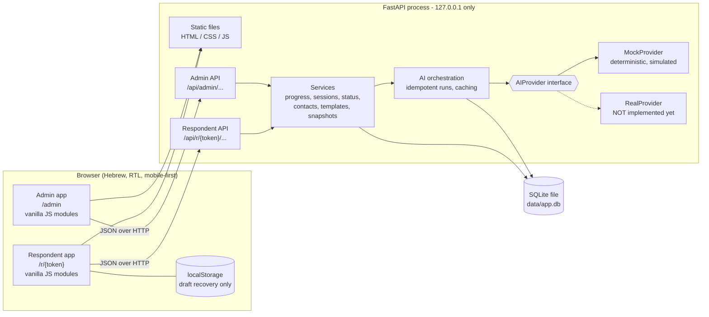
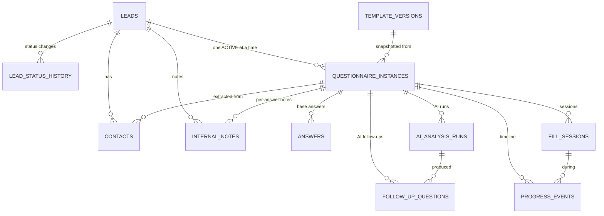
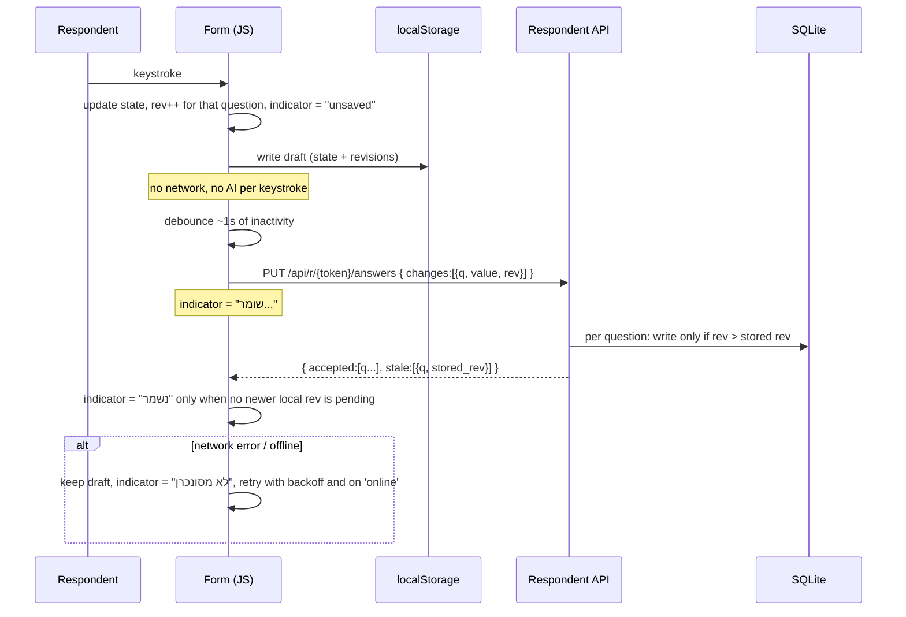

# AI Client Discovery - Architecture

Status: **Approved for local assignment MVP** (v0.2). Covers Lesson 9 phases **Design** and **Place**. **No deployment** is planned or performed in this assignment.

Approved decisions in force: Python + FastAPI + SQLite + HTML/CSS/vanilla JS (no Node.js, no React); private GitHub repository; no admin authentication in the local-only MVP (synthetic data only; authentication mandatory before deployment, section 9.3); deterministic mock AI first, real AI and real-model Evals only after explicit approval; auto follow-ups (max 5) after the base questionnaire; one automatic analysis run after final submission, no duplicates, admin retry only on failure; configurable contact groups; date-picker questions; locally bundled open-licensed Hebrew font; all approved product features in scope; automated Tests, simulated Evals and responsive checks inside the assignment milestones.

Related documents: `SPEC.md` (what to build), `practice.md` (how we work). Where this file makes a decision that refines SPEC.md, it is recorded in the Decision Log (section 12).

Conventions: documentation is English; all end-user UI text is Hebrew, RTL. Status labels, the questionnaire title pattern and the 18 original questions are taken verbatim from SPEC.md and are not repeated here.

---

## 1. Goals and constraints

| Constraint | Source | Consequence |
|---|---|---|
| Python, FastAPI, SQLite, HTML, CSS, vanilla JavaScript. No Node.js, React or frontend frameworks | Owner decision 1 | No build step; static files served by FastAPI; browser ES modules |
| Local only, bound to localhost, synthetic data only | Owner decision 3 | No admin authentication in the MVP; strong guards against accidental exposure (section 9) |
| Mock AI first, real provider pluggable later | Owner decisions 6, 7, 10 | `AIProvider` interface; every AI output carries `provider` and `is_simulated` |
| No paid services, no external AI calls, no deployment | SPEC section 7, practice section 5 | CI and tests are network-independent and need no secrets |
| Mobile-first, Hebrew RTL, approved palette | SPEC section 8 | CSS built from narrow widths up, logical properties, design tokens |
| Small scale: 1-5 staff, tens of leads | SPEC section 1 | One process, one SQLite file, no queue, no cache server |

---

## 2. Component overview



Key boundaries:

- **Two separate API surfaces.** `/api/r/{token}/...` (respondent) and `/api/admin/...` (internal). They use **separate response schemas**; respondent responses are built from an explicit allow-list of fields, never from raw database rows. This is what keeps internal notes, AI analysis and follow-up rationales out of the respondent path.
- **AI is behind one interface.** Services call the orchestration layer, never a provider directly. Swapping providers is a configuration change plus one new class.
- **The browser is a client, not a source of truth.** `localStorage` is a recovery aid only.

### 2.1 Proposed repository layout (created only after approval of the setup stage)

```
SPEC.md  practice.md  architecture.md  README.md  .gitignore  .env.example
app/
  main.py              # app factory, startup guards, static mounting
  config.py            # env-driven settings
  db.py                # sqlite3 connection, migration runner
  migrations/          # numbered .sql files (0001_init.sql, ...)
  api/                 # admin_*.py, respondent.py (thin routers)
  schemas/             # pydantic models: admin_out.py, respondent_out.py, ...
  services/            # progress.py, sessions.py, status.py, contacts.py,
                       # templates.py, instances.py, autosave.py
  ai/                  # base.py, mock.py, registry.py, orchestration.py, prompts/
  static/
    admin/  respondent/  shared/
    css/tokens.css base.css ...
    js/                # ES modules
tests/                 # pytest: unit, API, e2e/responsive
evals/
  cases/               # synthetic Hebrew questionnaire cases (JSON)
  run_evals.py
  reports/             # labelled results (simulated vs real)
.github/
  workflows/ci.yml
  ISSUE_TEMPLATE/  pull_request_template.md
```

Dependencies (all free): `fastapi`, `uvicorn`, `pydantic`, `httpx` (test client), `pytest`, `playwright` (Python; downloads a free Chromium for responsive tests). No ORM: plain `sqlite3` with SQL migrations, to keep the learning surface small and the schema visible.

---

## 3. Data model

### 3.1 Entity relationships



There is no `users` table in the MVP (no authentication). Notes store a fixed `author_label` (`"Demo admin"`) so that adding real users later is a column migration, not a redesign.

### 3.2 Tables

All timestamps are stored as UTC ISO-8601 text and displayed in `Asia/Jerusalem`. All IDs are opaque text (ULID/UUID); question IDs are described in 3.3.

| Table | Key columns and rules |
|---|---|
| `leads` | `id`, `company_name`, `contact_name?`, `email`, `phone`, `status` (one of the 5 Hebrew statuses), `created_at`, `updated_at`. All demo rows flagged fictional in seed data. |
| `lead_status_history` | `lead_id`, `from_status`, `to_status`, `changed_at`, `changed_by`, `reason?`. Append-only. |
| `template_versions` | `id`, `version_number` (unique), `state` (`draft` / `published`), `intro_text`, `title_pattern`, `definition` (JSON, see 3.3), `created_at`, `published_at?`. Version 1 is seeded from SPEC section 5 and never modified. At most one `draft` row at a time. Published rows are immutable. |
| `questionnaire_instances` | `id`, `lead_id`, `template_version_id`, `definition_snapshot` (JSON copy), `state` (`active` / `void`), `phase` (`base` / `followups` / `submitted`), `token_hash`, `link_revoked_at?`, `link_expires_at?`, `sent_at?`, `first_opened_at?`, `first_answer_at?`, `last_activity_at?`, `base_completed_at?`, `submitted_at?`, `created_at`. **Partial unique index on `(lead_id) WHERE state = 'active'`** enforces one active questionnaire per lead. |
| `answers` | `instance_id`, `question_id`, `value` (JSON: string, date string, or list of person objects), `revision` (int), `updated_at`. `UNIQUE(instance_id, question_id)`. One current row per question; the history is the progress timeline, not a keystroke log. |
| `follow_up_questions` | `id`, `instance_id`, `ai_run_id`, `ordinal`, `text` (Hebrew), `rationale` (internal), `source_question_ids` (JSON), `status` (`pending` / `answered` / `skipped`), `answer_text?`, `answered_at?`. CHECK ordinal between 1 and 5. |
| `fill_sessions` | `id`, `instance_id`, `started_at`, `last_heartbeat_at`, `ended_at?`, `end_reason` (`explicit_save` / `idle` / `hidden` / `submitted` / `unknown`), `active_seconds`. |
| `progress_events` | `id`, `instance_id`, `session_id?`, `type` (`opened`, `first_answer`, `progress_changed`, `paused`, `resumed`, `draft_saved`, `base_completed`, `followups_shown`, `submitted`, `link_revoked`, ...), `completion_pct`, `at`, `meta` (JSON). Written only at meaningful milestones (progress crosses a 10-point step, section completed, etc.), never per keystroke. |
| `contacts` | `id`, `lead_id`, `name`, `role?`, `responsibility?`, `phone?`, `email?`, `origin` (`extracted` / `manual`), `is_sponsor`, `source_instance_id?`, `source_question_id?`, `dedupe_key`, `created_at`, `updated_at`, `removed_at?`. See 5.5. |
| `internal_notes` | `id`, `lead_id`, `instance_id?`, `question_id?` (null = general lead note), `follow_up_id?`, `author_label`, `body`, `created_at`. **Append-only** in the MVP: no edit, no delete. Many rows per question. |
| `ai_analysis_runs` | `id`, `instance_id`, `kind` (`follow_ups` / `analysis`), `provider`, `model?`, `is_simulated` (bool), `prompt_version`, `input_hash`, `status` (`pending` / `succeeded` / `failed`), `output` (JSON), `error?`, `created_at`, `completed_at?`. **Partial unique index on `(instance_id, kind) WHERE status IN ('pending','succeeded')`** guarantees at most one live or successful run per kind. |

Rules that hold across tables:

- Original answers are never rewritten by AI output, by contact edits, or by template edits.
- Verbatim client text (`answers`, `follow_up_questions.answer_text`), AI output (`ai_analysis_runs.output`) and team text (`internal_notes`) live in separate tables, which makes the three-way separation required by SPEC section 4 structural rather than a display convention.

### 3.3 Template definition JSON

```jsonc
{
  "sections": [
    {
      "id": "sec_<stable>",
      "title": "חלק א': ...",
      "active": true,
      "questions": [
        {
          "id": "q_<stable>",              // generated once, never reused, never changed
          "type": "long_text",             // long_text | short_text | date | person_group
          "label": "מהו האתגר המרכזי ...",
          "required": false,
          "active": true,                  // archive instead of delete
          "tag": null,                     // semantic tag, see below
          "config": {}                     // type-specific
        }
      ]
    }
  ]
}
```

- **Supported types:** `long_text`, `short_text`, `date` (native `<input type="date">` calendar picker; free, no library, localized by the browser), `person_group`.
- **`person_group` config:** `{ "fields": ["name","role","responsibility","phone","email"], "required_fields": ["name"], "min": 0, "max": 20 }`. Each question chooses which sub-fields appear. Question 5 of v1 uses `name, role, responsibility`; question 6 (sponsor) uses `name, role` with `max: 1`. Phone and email are optional sub-fields available to any group. *(See decision D-12: this reconciles owner decision 5 with the SPEC question 5 wording.)*
- **Semantic tags:** `stakeholders`, `sponsor`, `end_users`, and `null`. Contact extraction reads tags, never question numbers, so reordering or rewording cannot break it. A tag may appear on at most one active question per template version (validated at publish).
- **Stable IDs:** the editor generates IDs; the admin cannot type or edit them. Reorder changes only array position. "Remove" sets `active: false` for questions that already have answers anywhere, and the editor hides inactive questions from new instances only. Brand-new unpublished questions in a draft may be hard-deleted from the draft.
- **Numbering** shown to the respondent is computed from position in the snapshot, not stored.

---

## 4. Key flows

### 4.1 Lead creation, questionnaire instance, and link

```mermaid
sequenceDiagram
  actor Admin
  participant UI as Admin app
  participant API as Admin API
  participant DB as SQLite

  Admin->>UI: Create lead (company, email, phone)
  UI->>API: POST /api/admin/leads
  API->>DB: insert lead (status חדש) + status history
  Admin->>UI: Create questionnaire
  UI->>API: POST /api/admin/leads/{id}/instances
  API->>DB: copy latest PUBLISHED template into definition_snapshot
  API->>DB: insert instance (state active, token_hash)
  API-->>UI: link shown ONCE (raw token is never stored)
  Admin->>UI: Copy link, send it outside the app
  Admin->>UI: Mark as sent
  UI->>API: POST /api/admin/instances/{id}/mark-sent
  API->>DB: sent_at = now; status חדש to ממתין למילוי; history row
```

- The system **never sends email**. "Mark as sent" only records a timestamp the admin asserts (SPEC section 2 step 3).
- Only the **hash** of the token is stored. The raw link is displayed at creation or regeneration. If lost, the admin revokes and regenerates (rotation). This is a deliberate small-security / small-convenience trade-off.
- Creating a second instance while one is `active` is rejected; the admin may void the active one first (void keeps all its data).

### 4.2 Autosave (the most failure-prone path)



**Ordering and conflict rules (documented behavior):**

1. Each question has a **client-side monotonically increasing revision**, persisted in `localStorage` with the draft.
2. The server applies a change only if `rev` is higher than the stored revision for that question. Older or duplicate writes are acknowledged as `stale` and ignored, so a slow older request can never overwrite a newer edit, and retries are idempotent.
3. Only one save request is in flight at a time per form; edits during a flight are batched into the next request.
4. "Saved" is shown only when the server acknowledged **the latest** local revision of every dirty question.
5. "שמירת טיוטה ויציאה" flushes immediately, waits for the acknowledgment, then leaves.
6. **Known limitation:** two devices editing the same link simultaneously resolve per question by higher revision (effectively last-writer-wins). The MVP does not merge. This is documented and has a regression test.
7. On load, the client compares server answers with the local draft: if local has a higher revision for a question, it re-sends it; otherwise server state wins. The draft is removed from `localStorage` after final submission.

### 4.3 Base questionnaire to follow-ups to final submission

```mermaid
sequenceDiagram
  actor Lead as Respondent
  participant API as Respondent API
  participant ORC as AI orchestration
  participant P as AIProvider (Mock)
  participant DB as SQLite

  Lead->>API: POST /continue  (המשך לשליחה)
  API->>DB: flush answers; validate required; phase = followups; base_completed_at
  API->>ORC: generate_follow_ups(instance)
  ORC->>DB: insert run(kind follow_ups, pending) - unique index blocks duplicates
  ORC->>P: structured input (answers only)
  alt success
    P-->>ORC: 0-5 questions + rationale + source IDs
    ORC->>ORC: validate: max 5, no duplicates, source IDs exist, Hebrew text
    ORC->>DB: run succeeded; insert follow_up_questions
  else failure / timeout / invalid output
    ORC->>DB: run failed (error recorded)
    Note over Lead,API: respondent is NOT blocked; zero questions shown
  end
  API-->>Lead: follow-ups (text only; rationale and source IDs stripped)
  Lead->>API: answer or skip each (optional)
  Lead->>API: POST /submit  (שליחה סופית)
  API->>DB: single transaction: phase = submitted, submitted_at, status = התקבל, event
  API-->>Lead: confirmation; form is now read-only
  API->>ORC: trigger analysis ONCE (background task)
  ORC->>DB: insert run(kind analysis, pending) or no-op if one exists
  ORC->>P: analyze(submitted answers + follow-up answers)
  P-->>ORC: structured analysis
  ORC->>DB: run succeeded, output stored
```

Properties:

- **Idempotent submit.** The submit transaction checks `phase` first; a double click or retried request returns the existing result and creates nothing new. Same for `/continue` (the unique run index prevents a second follow-up run).
- **Follow-up generation is synchronous** with a short timeout (the mock returns instantly; a future real provider must meet the same budget or the failure path applies). Follow-ups are generated **once per instance**; going back to edit and continuing again reuses the stored run unless the admin voids and recreates the instance. *(Decision D-9.)*
- **Original progress never decreases**: follow-up answers are tracked separately (asked / answered / skipped) and excluded from the base completion percentage.
- **Analysis runs once, automatically, after submit.** Opening the analysis tab only reads `ai_analysis_runs.output`. If the run is `failed`, the admin sees "analysis unavailable" with an **explicit "retry" button**, which creates a new run row after confirmation. No other path calls the provider. *(Decision D-10.)*
- The analysis run state (`pending` / `succeeded` / `failed`) is shown in the admin UI, together with a visible **"simulated"** badge when `is_simulated` is true.

### 4.4 Activity, sessions and active time

- A **session** starts when the respondent page becomes visible and the form loads, and is closed when: the tab is hidden, the user saves and exits, final submission occurs, or **5 minutes pass without interaction** (key/touch/scroll/click), whichever comes first. A later return opens a **new session** (this is what "distinct filling sessions" counts).
- While visible and not idle, the page sends a heartbeat every 15 seconds. The **server** computes `active_seconds += min(now - last_heartbeat_at, 30s)`. Computing on the server, with a cap, prevents double counting from retries or multiple tabs (a second tab opens its own session, and overlapping intervals are the documented known approximation).
- Active time is therefore **approximate by design**, and the admin UI labels it as such.
- Tracked: timestamps, completion percentage at milestones, session start/end. **Not tracked:** keystroke content/timing, mouse movement, device fingerprints, IP addresses.

### 4.5 Progress percentage

`completion_pct = answered_active_questions / total_active_questions`, using the instance's **frozen snapshot** (never the live master template).

- A `long_text`, `short_text` or `date` question counts as answered when its trimmed value is non-empty.
- A `person_group` question counts as answered when at least one row has all of that group's `required_fields` filled. One question counts once regardless of the number of rows.
- Optional and required questions both count in the denominator (decision D-8, replacing the undefined "applicable" wording in SPEC section 3).
- The respondent sees a simple progress bar; the admin sees the percentage and the completed sections.

### 4.6 Contacts extraction

On final submission, a service reads the snapshot for questions tagged `stakeholders` and `sponsor` and creates `contacts` rows:

- `dedupe_key = normalize(name) + "|" + normalize(email or "")` where normalize lowercases, trims and collapses whitespace.
- If a row with the same `lead_id` and `dedupe_key` exists (extracted or manual), it is **not duplicated**; if the same person appears as stakeholder and sponsor, the existing row gets `is_sponsor = true`.
- Extraction stores provenance (`source_instance_id`, `source_question_id`) and `origin = 'extracted'`. Manual contacts have `origin = 'manual'`.
- Admin edits and removals (soft-delete via `removed_at`) change only `contacts`. They never touch `answers`.
- A soft-deleted extracted contact is **not re-created** by a later extraction (the dedupe key still matches).

### 4.7 Template editing and versioning

- The admin edits a single `draft` row: add/remove/edit/reorder sections and questions, change type, required flag, tag, and person-group fields. Reorder uses **up/down buttons** (works on touch and keyboard; no drag-and-drop dependency).
- **Preview** renders the draft through the same respondent renderer in a read-only mode.
- **Publish** validates (unique tags, at least one active question, stable IDs intact, no type change on a question ID that already has answers in any instance) and writes a new immutable `version_number`. Existing instances keep their snapshots; only new instances use the new version.
- Version 1 is the seeded original and cannot be modified.

### 4.8 Status model

`חדש` to `ממתין למילוי` (on mark-sent) to `התקבל` (automatic on final submission) to `בבדיקה` to `הושלם`.

- The admin may move **forward one step** (only `התקבל` onward, since `ממתין למילוי` to `התקבל` is reserved for the system) or **back one step** with a mandatory reason. Every change writes `lead_status_history`.
- Draft activity is **not a status**; it is derived from sessions and answers: not started / started / saved and left / resumed, plus last saved time.

---

## 5. API surface (sketch)

Respondent (`/api/r/{token}`; token resolved by hash; unknown, revoked or expired all return the same 404):

| Method | Path | Purpose |
|---|---|---|
| GET | `/` | Heading, intro, questions, own answers, phase, follow-ups (allow-listed fields) |
| PUT | `/answers` | Batched autosave with revisions |
| POST | `/activity` | Heartbeat / session events |
| POST | `/save-draft` | Flush and close session |
| POST | `/continue` | Validate, generate follow-ups |
| PUT | `/follow-ups/{id}` | Answer or skip |
| POST | `/submit` | Final submission |

Writes to a submitted instance return 409 (read-only). Admin (`/api/admin/...`): leads CRUD, instances (create, mark-sent, revoke, regenerate, void), instance detail with progress, sessions and timeline, notes (list/add per answer or per lead), contacts CRUD, status change, AI run view and retry, template draft CRUD / reorder / preview / publish.

---

## 6. AI component

### 6.1 Provider interface

```python
class AIProvider(Protocol):
    name: str            # "mock" | future "anthropic", ...
    model: str | None
    is_simulated: bool   # True for MockProvider, always

    def generate_follow_ups(self, request: FollowUpRequest) -> FollowUpResult: ...
    def analyze(self, request: AnalysisRequest) -> AnalysisResult: ...
```

Requests and results are Pydantic models. A provider returns **structured data only**; the orchestration layer validates it (counts, ID existence, schema) before anything is stored, so a real model's mistakes cannot corrupt the database. Provider selection is `AI_PROVIDER=mock` (default) in the environment, resolved in `ai/registry.py`.

### 6.2 What is stored with each result

Every `ai_analysis_runs` row records `provider`, `model`, `is_simulated`, `prompt_version`, `input_hash`, status and timestamps. The admin UI renders a visible label (for example **"סימולציה - לא תוצאת מודל אמיתי"**) whenever `is_simulated` is true. Eval reports carry the same field in their header (section 10).

### 6.3 MockProvider (deterministic, rule-based)

- **Follow-ups:** a fixed Hebrew question bank keyed by question ID and gap type. Gap rules examples: answer empty; answer shorter than a word threshold; no number or measure in the KPI question; "unknown" markers; contradictory markers between answers is *not* attempted. Output is ordered by a fixed priority, capped at 5, and skips any bank question whose source answer is adequate. Zero questions is a normal result. No question asks for secrets or personal data.
- **Analysis:** fills the SPEC section 7 headings (business need, current workflow, outcomes/KPIs, stakeholders and systems, data and security considerations, unknowns, suggested next-call questions, tentative directions) by quoting submitted answers verbatim with source question IDs, listing unanswered questions under "unknowns", and emitting directions only as labeled hypotheses from a small rule table. It never states budgets, API availability, KPIs or commitments the respondent did not provide.
- Same input produces the same output (no randomness, no clock inside the output), which is what makes it usable for exact test assertions.

The mock proves the **plumbing and safety rules**, not language quality. It must never be described as evidence of model quality.

### 6.4 Connecting a real provider later (not part of this assignment)

Adding a provider means: one new class implementing the interface, one registry entry, a documented prompt version, and an approved key in a local `.env`. Before any real call: owner approval of provider, model, budget cap, and a data-handling statement. In the MVP no real client data exists, only synthetic cases; sending real client answers to an external provider is a separate decision (privacy, consent, terms).

---

## 7. Frontend architecture

- **Static HTML shells** (`/admin/...`, `/r/{token}`), each loading ES modules. No framework, no bundler, no CDN. `<html lang="he" dir="rtl">`.
- **Small module set:** `api.js` (fetch wrapper), `state.js` (tiny store), `autosave.js` (the state machine in 4.2), `activity.js` (heartbeat/idle), `render/*.js` (DOM builders using `textContent`, never `innerHTML` with user data), `i18n-he.js` (all UI strings), `format.js` (dates, LTR islands).
- **Design tokens** in `tokens.css`: the five palette colors and three soft backgrounds from SPEC section 8, spacing, radius, focus ring. Mobile-first CSS: base styles target ~320px; `@media (min-width: ...)` adds layout for 768px and 1280px. **CSS logical properties** (`margin-inline-start`, `padding-inline`, `inset-inline-*`) instead of left/right.
- **Mixed direction:** emails, phone numbers, URLs, IDs and numbers are wrapped in `<bdi>` / `dir="ltr"` islands so they don't scramble in RTL text; note bubbles use `overflow-wrap: anywhere`.
- **Accessibility:** real `<label>`s, visible focus rings, 44px minimum touch targets for key controls, status chips carry text (and an icon/shape) in addition to color, `aria-live` region for the save indicator and validation messages.
- **Responsive patterns:** person groups render as stacked cards at every width (a table is never used); the admin dashboard uses a card list on narrow screens and a denser layout from 768px; lead-detail tabs use a scrollable or wrapping tab bar with a `role="tablist"` pattern; notes appear beneath their answer on phones and beside it from ~1024px; the template editor uses explicit move-up / move-down buttons.
- **Font:** Heebo (or another open-licensed Hebrew font; Heebo is SIL OFL) is **bundled locally** under `app/static/fonts/` with its license file, loaded via `@font-face` with `font-display: swap`, and no runtime request to any font CDN. The font file is downloaded once, when implementation begins (in the app-skeleton issue), from its official source, and committed with its license. Until then, and as fallback, a Hebrew-capable system font stack is used (decision D-14).

---

## 8. Placement (the "Place" phase)

### 8.1 Where each component runs in this assignment

| Component | Placement | Notes |
|---|---|---|
| FastAPI app + static files | One `uvicorn` process on the owner's Windows machine, `127.0.0.1:8000` | Same process serves admin and respondent pages |
| SQLite database | `data/app.db`, git-ignored, WAL mode, single writer | Suitable for tens of leads and 1-5 staff |
| Respondent browser | The owner's own browser/phone-emulation on localhost | A real phone cannot reach it by design; mobile is verified by emulation (see 10.3) |
| AI | `MockProvider` in-process | No network call, no secrets |
| CI | GitHub Actions runners (free tier) | Tests, evals (simulated), lint; no secrets, no network need beyond package install |
| Secrets | None required. Optional `.env` (git-ignored) with `AI_PROVIDER`, `DATABASE_PATH`; `.env.example` lists names only | A future API key would live only in `.env` and CI secrets, never in the frontend or Git |

Local run is documented in `README.md` as: create a virtual environment, `pip install -r requirements.txt`, `uvicorn app.main:app --host 127.0.0.1`. Seed command creates synthetic leads clearly marked fictional.

### 8.2 Runtime limits (enforced in code)

| Limit | Value | Reason |
|---|---|---|
| Request body | 256 KB | Prevent abuse and accidental huge pastes |
| Answer text | 10,000 characters per answer | Bounds storage and AI input size |
| Person rows | 20 per group; 5 fields each | Bounds payloads |
| Follow-up questions | 5 per instance | Spec |
| Autosave write rate | ~60 writes/min/token (in-memory limiter) | Protect the DB from a runaway client |
| AI calls | 1 follow-up run + 1 analysis run per instance (plus explicit admin retry after failure) | Cost control and idempotency |
| Provider timeout | 20 s | Failure path must stay responsive |

### 8.3 Planned (not executed) future hosting

Planning only. Nothing here is purchased, provisioned or deployed. Prices are intentionally **not** stated because they are unverified; they would be checked at decision time.

| Concern | Direction | What changes from the local MVP |
|---|---|---|
| Hosting shape | A single container or small VM running the same FastAPI app, behind HTTPS | Reverse proxy / TLS from the platform |
| Database | Either a persistent disk for SQLite (single instance only) or a managed Postgres | SQLite file is lost on ephemeral disks; Postgres would need the SQL migrations adapted and a driver (not an ORM rewrite, since SQL is plain) |
| Authentication | **Mandatory before deployment or real data** (section 9.3) | Add login, roles, sessions, CSRF protection on all admin routes |
| Secrets | Platform secret store, never committed | `.env` replaced by platform variables |
| Backups | Scheduled DB backup and tested restore | Not needed for synthetic local data |
| Observability | Structured logs without answer content | Not needed locally |
| Domain / email | Not needed (email sending is a non-goal) | n/a |

### 8.4 Cost assumptions

| Item | Assumption | Status |
|---|---|---|
| Development tooling (Python, FastAPI, SQLite, Playwright/Chromium, pytest) | Free and open source | Planned: $0 |
| GitHub private repository, Issues, Projects | Included in the owner's GitHub plan | To verify |
| GitHub Actions on a private repo | Uses the plan's included free minutes; a test run of this size is expected to be a few minutes | To verify the quota; if exceeded, stop and ask, do not add a paid plan |
| GitHub branch protection / required checks on a private repo | May be limited on a free plan | To verify; fallback is a documented convention plus visible CI status on every PR |
| AI during this assignment | $0 (MockProvider only) | Committed |
| Future real AI | Cost per lead = (follow-up call + analysis call) x tokens x provider price. Rough planning assumption: each call sends the questionnaire answers (a few thousand tokens) and returns well under a few thousand tokens. **These numbers are assumptions, not measurements**; actual figures come from a real eval run | Requires explicit approval and a hard budget cap before any use |
| Hosting, domain | $0 now; none provisioned | Out of scope |

---

## 9. Security model and limitations

### 9.1 What the MVP does

- **Localhost only.** The server binds `127.0.0.1`. Startup **refuses** to run if `HOST` is set to a non-loopback address unless a clearly named override variable is set (and the README says not to).
- **Host-header allow-list** (`localhost`, `127.0.0.1`, `[::1]`) to defend the unauthenticated admin API against DNS-rebinding from a malicious web page open in the same browser.
- **Respondent access is capability-based.** Tokens are 32 random bytes (`secrets.token_urlsafe`), only a SHA-256 hash is stored, comparison is constant-time, and the token never appears in logs. Links are **revocable** and may have an optional expiry; revoked, expired and unknown tokens are indistinguishable (same 404).
- **Strict data separation.** Respondent endpoints return only allow-listed fields for their own instance. Notes, AI analysis, follow-up rationales, source question IDs for rationale, and other leads never appear in respondent schemas. Tests assert this by scanning respondent responses for forbidden keys.
- **Input handling.** Parameterized SQL only; length and type validation with Pydantic; output rendered with `textContent`; a restrictive Content-Security-Policy header (self-only scripts and styles, no inline script).
- **Privacy.** No IP storage, no keystroke logging, no analytics. Local drafts live in `localStorage` and are deleted after submission; on a shared device they remain until then or until the browser data is cleared, and the UI says so near "save draft".
- **Synthetic data only**, and `data/`, `.env` and local databases are git-ignored.

### 9.2 Known limitations (accepted for the local assignment demo)

1. **No administrator authentication.** Anyone who can reach the admin routes can read and change everything. Safe only because the server is bound to localhost on the owner's machine and holds fictional data.
2. **A fixed demo author** is recorded on all notes and status changes; there is no accountability.
3. **No CSRF protection** on admin routes (acceptable only because there is no login session to abuse; mitigated partly by the Host allow-list and the `Content-Type: application/json` requirement). Becomes mandatory with auth.
4. **An unguessable link is not authentication of a person.** Anyone holding the link can read and edit the answers until submission or revocation.
5. **Token shown once.** A lost link requires revoke and regenerate.
6. **Browser storage** is not encrypted and is shared by anyone using the same browser profile.
7. **SQLite file is unencrypted**, with no backup, no audit trail beyond the history tables.
8. **Two-device concurrent editing** is last-higher-revision-wins per question (4.2).
9. The mock AI does no real language understanding; it will miss gaps and cannot judge answer quality.

### 9.3 Mandatory before any public deployment or real client data

These are requirements, not suggestions. The system must **not** be exposed beyond localhost or loaded with real client information until all of them are done:

1. Admin **authentication** (individual accounts, secure password storage or a managed identity provider, session handling, logout, lockout/rate limiting).
2. **Role-based access control** (at minimum: admin vs. read-only team member), enforced server-side on every admin route, with real authors on notes and history.
3. **CSRF protection** and secure cookie flags on admin sessions.
4. **HTTPS** everywhere, HSTS, no secrets in URLs other than the respondent capability token, and Referrer-Policy that prevents token leakage.
5. Link policy for real use: expiry by default, rotation, revocation UI, rate limiting on token lookups.
6. Backups with a tested restore, a retention and deletion policy for client data, and a data-processing decision before any real client data goes to an external AI provider.
7. Security review of the AI path (prompt-injection from respondent text, output validation already in 6.1, logging that excludes answer content).
8. Dependency pinning and vulnerability scanning in CI.

---

## 10. Test and Eval architecture (the "Test/Eval" phase)

### 10.1 Layers

| Layer | Tooling | What it proves |
|---|---|---|
| Unit | pytest | Progress %, dedupe keys, status transitions, template validation, revision ordering, active-time calculation |
| API / integration | pytest + FastAPI TestClient on a temp SQLite | Snapshot immutability, one-active-instance rule, read-only after submit, idempotent submit and AI runs, note visibility (respondent never sees internal data), revoked-link behavior |
| Regression (named in practice.md) | pytest | Save races (older revision cannot overwrite newer), duplicate submit, duplicate AI run, offline retry behavior |
| Responsive smoke | Playwright (Python) | Respondent and admin flows at 320, 375, 768 and 1280px: no horizontal overflow, key controls visible, touch target sizes, RTL direction, save indicator states |
| Manual | Checklist in the PR | Real touch behavior, long Hebrew text, focus order; reported separately from automated results |

Tests use **fixed fictional fixtures** and the MockProvider only. They need no network and no secrets, so they can gate every PR.

### 10.2 Evals

- **Cases** live in `evals/cases/*.json`: a synthetic Hebrew questionnaire (all 18 answers), plus labels: `expected_gaps` (what is genuinely missing), `must_not_ask` (already-answered topics, sensitive data), `forbidden_claims` (facts not present in the answers, for example a budget or an API that was never mentioned). Cases are fictional and marked as such.
- **Deterministic checks** (exact, usable with mock): valid structured output, at most 5 follow-ups, no duplicates of answered topics, source question IDs exist, no request for secrets, analysis sections present, every claim has a source ID, "unknowns" include all unanswered questions.
- **Rubric checks** (for real-model runs): follow-up relevance, missing-information detection (recall against `expected_gaps`), factual accuracy (claims traceable to answers), and avoidance of invented information (no `forbidden_claims`).
- **Reports** in `evals/reports/` carry a header: `provider`, `model`, **`is_simulated`**, date, git commit, case set version, prompt version. Mock reports are titled "Simulated checks - not model evaluation". The runner **refuses** to write a report as "real" unless the provider reports `is_simulated = false`, and a real run requires an explicit flag plus an approved key; it never runs in default CI.
- **Real Evals are a later, separately approved step** (owner decision 10): provider, model and a hard budget are approved first; the cost and results are then recorded as measured, never estimated or invented. Until then, the report states "real-model Evals: not run".

### 10.3 CI

`.github/workflows/ci.yml`: on pull request and push to a feature branch: set up Python, install pinned requirements, install Playwright Chromium, run lint, pytest (including responsive smoke), and the simulated eval checks. No secrets, no paid APIs. Results visible on every PR. Whether "required status check" can be enforced on a private free-plan repo is an open verification item (section 8.4).

**Mobile verification honesty:** responsive checks run in a desktop browser at emulated widths. They are not a substitute for a physical phone and the PR checklist must say which checks were automated and which were manually inspected.

---

## 11. Smallest practical scope

The requirements in SPEC.md and the owner's decisions all remain in force. This section defines the **smallest slice that demonstrates all four lesson phases with real, working software**, and the order in which the rest follows.

**Minimum demonstrable slice (Milestones M0 to M5):**

- **Design:** this file and SPEC.md, merged through a PR.
- **Place:** section 8 of this file, merged, plus the working localhost setup with its guards.
- **Manage:** private repo, Project board, small Issues with acceptance criteria, branch and PR per issue, PR template, `CLAUDE.md` pointer (after approval).
- **Test/Eval:** pytest suite and CI green, simulated eval cases and report, responsive smoke at 4 widths.
- **Working product path:** create a lead, snapshot the v1 questionnaire, share a link, fill with autosave, resume, continue, get mock follow-ups, final submit, read-only, automatic one-time mock analysis visible to the admin with the "simulated" label, per-answer notes.

**Follow-on slices (all in scope, built after the minimum slice is solid):** full session/active-time timeline UI, contacts extraction and management, status history UI polish, link revoke/regenerate UI, and the **full template editor** (add/remove/edit/reorder, publish, preview). The editor is last because it is the largest and riskiest piece and nothing else depends on it (v1 is seeded). The owner has confirmed that all approved product features, including the editable template, remain in scope. Automated tests, simulated Evals and responsive checks are part of the assignment milestones (M2 CI foundation, M6 Evals and responsive gate), and each later feature issue adds its own tests. Any descoping would be an explicit owner decision recorded in the decision log, never silent.

---

## 12. Decision log

| ID | Decision | Alternatives considered | Why / trade-off |
|---|---|---|---|
| D-1 | Python + FastAPI + SQLite + vanilla JS, no Node | React + Vite; server-side Jinja | Owner decision. Fewer tools to install and learn; logic stays in testable Python. Cost: more hand-written DOM code, mitigated by small modules and strict conventions. |
| D-2 | Plain `sqlite3` + numbered SQL migrations, no ORM | SQLModel / SQLAlchemy | Schema stays visible and teachable; fewer dependencies. Cost: hand-written queries, mitigated by thin service functions and tests. |
| D-3 | No admin auth in MVP; localhost-only with startup guard, Host allow-list, synthetic data | Simple password login | Owner decision. Auth and RBAC documented as mandatory before deployment or real data (9.3). |
| D-4 | Fixed demo author on notes/history; `author_label` column | Users table now | Owner decision. Keeps schema forward-compatible with real users. |
| D-5 | Respondent link = random token, hash stored, shown once, revocable, optional expiry | Store raw token; short codes | A DB leak does not reveal usable links. Cost: lost link needs regeneration. |
| D-6 | Separate respondent and admin API surfaces with allow-listed response schemas | One API with role filtering | Makes "lead can never see notes/AI" structural and testable. |
| D-7 | Per-question client revisions; server applies only higher revisions; batched debounced saves | Last-request-wins; full-form PUT | Prevents slow older requests from overwriting newer edits; idempotent retries. Cost: limited multi-device merge (documented). |
| D-8 | Completion % = answered active questions / total active questions in the frozen snapshot; person group counts once | Weighted by required only | Resolves the undefined "applicable" wording. Simple and explainable. |
| D-9 | Follow-ups generated once per instance, synchronously with timeout; failure does not block | Regenerate on each continue | Cost control and determinism; owner decision 8 plus SPEC section 7. |
| D-10 | Analysis auto-triggered once after final submission as a background task; stored; viewing never calls the provider; explicit admin retry allowed only when the run `failed` | Generate on admin open; allow free regeneration | **Confirmed by owner.** Avoids a permanent "unavailable" state; the retry button is hidden unless the latest run is `failed`, and the unique index still blocks a second live or successful run. |
| D-11 | `ai_analysis_runs.is_simulated` + UI label + eval report header; runner refuses to mislabel | Convention only | Owner decision 7: simulated output can never pass as real evaluation. |
| D-12 | `person_group` has configurable sub-fields from name, role, responsibility, phone, email | Fixed name/role/phone/email | Reconciles owner decision 5 (name, role, optional phone/email) with SPEC question 5 (name, role, responsibility). Sponsor uses `max: 1`. **Confirmed by owner:** Q5 keeps name, role, responsibility; Q6 keeps name, role. |
| D-13 | Semantic tags (`stakeholders`, `sponsor`, `end_users`) drive extraction, unique per template version | Extraction by question number | Owner decision 5; reorder-safe. |
| D-14 | Heebo (open license) bundled locally with its license file, downloaded once at the start of implementation; system Hebrew font stack as fallback | Google Fonts CDN; system fonts only | **Approved by owner.** No external requests at runtime; consistent Hebrew typography. Cost: a small font file in the repo. |
| D-15 | Single master template table (`template_versions`) instead of separate template + version tables | Two tables | One template exists; simpler. Revisit if multiple templates are ever needed. |
| D-16 | Partial unique indexes enforce one active instance per lead and one live AI run per kind | Application-level checks only | Races cannot create duplicates; enforced by the database. |
| D-17 | Status moves: forward one step from `התקבל` onward, back one step with a reason, system-only into `התקבל` | Free status editing | Implements SPEC "controlled admin changes" with an audit trail. |
| D-18 | Notes are append-only, no edit/delete in MVP | Editable notes | SPEC requires preserving old notes; simplest defensible rule. |
| D-19 | Native `<input type="date">` for the calendar picker | Custom date picker library | Free, accessible, localized, no dependency; styling differs by browser (accepted). |
| D-20 | Responsive tests via Playwright emulation, clearly reported as emulation | Physical device testing | Keeps CI free and reproducible; manual touch review is a PR checklist item. |

---

## 13. Resolved decisions and remaining items

Resolved by the owner: D-10 (retry only after failure), D-12 (configurable contact groups preserving Q5/Q6 fields), D-14 (Heebo bundled locally), private repository, and the full feature scope including the template editor.

Remaining, none blocking the documentation stage:
1. Verify GitHub plan limits (private-repo Actions minutes, branch protection / required checks) before relying on them; fallback is documented in 8.4.
2. Instructor access: a collaborator invite later; nothing is shared or pushed until the setup stage is approved.
3. Real AI provider, model, budget and real-model Evals: deferred until separately and explicitly approved.

---

## 14. Proposed milestones and first GitHub Issues

Milestones map to the four lesson phases and to SPEC section 12 slices. Each issue is small, has "Done when" criteria, and gets its own branch and PR. **Nothing below is created on GitHub until you approve the setup stage.**

### Milestone M0 - Design and Place (docs)
1. **Add architecture.md** (this document, reviewed) - Done when: owner approves; diagrams render on GitHub.
2. **Add README with local run instructions, `.gitignore`, `.env.example`** - Done when: a fresh clone can follow the README (no code yet beyond placeholders).

### Milestone M1 - Manage setup
3. **Repository hygiene: issue templates, PR template, labels per phase, Project board columns (To do / In progress / Done)** - Done when: a sample issue and PR use the templates.
4. **Add minimal `CLAUDE.md` pointer to SPEC.md, practice.md, architecture.md** (needs approval) - Done when: file contains pointers only.

### Milestone M2 - Walking skeleton and Test/Eval foundation
5. **App skeleton: FastAPI app factory, localhost guard, Host allow-list, health route, static shell, config, bundled Heebo font with license** - Done when: server refuses a non-loopback host; test proves it; Hebrew text renders in the bundled font with no external requests.
6. **SQLite migrations runner and initial schema (3.2) with partial unique indexes** - Done when: schema tests pass on a temp DB.
7. **CI workflow: lint + pytest on PR, no secrets** - Done when: a PR shows a green check.
8. **Seed v1 template (18 questions, original Hebrew wording and sections) and synthetic demo leads** - Done when: seed is idempotent; fixtures marked fictional.

### Milestone M3 - Leads and instances
9. **Create/edit lead; dashboard list with status, sent date, elapsed days (mobile card layout)** - Done when: SPEC acceptance 1-2.
10. **Create questionnaire instance with frozen snapshot, token link (hash stored, shown once), mark as sent, revoke/regenerate, one-active rule** - Done when: snapshot immutability and one-active tests pass.

### Milestone M4 - Respondent form
11. **Respondent form renderer for all field types, Hebrew RTL, mobile-first, person-group cards** - Done when: renders at 320/375/768/1280 without horizontal scroll.
12. **Autosave state machine (revisions, debounce, local draft, indicator, offline retry), save draft and resume** - Done when: race, offline and refresh regression tests pass.
13. **Progress percentage and respondent progress bar** - Done when: unit tests cover all field types.

### Milestone M5 - AI and submission (the minimum demonstrable slice completes here)
14. **AIProvider interface, orchestration with idempotent runs, MockProvider follow-ups (0-5), failure path** - Done when: SPEC acceptance 10 holds with the mock; labeled simulated.
15. **Continue, follow-up answer/skip, final submit (idempotent), read-only after submission, status to `התקבל`** - Done when: double-submit regression test passes.
16. **Auto-trigger mock analysis once after submit; admin AI tab with simulated badge and source IDs; never re-called on view** - Done when: view-twice test shows one provider call.
17. **Internal notes: per-answer threads and lead notes, bubbles, respondent never sees them** - Done when: respondent-schema leak test passes.

### Milestone M6 - Test/Eval and responsive gate
18. **Eval cases (synthetic Hebrew), runner, simulated report with labeling rules** - Done when: report header shows `is_simulated: true` and "real Evals: not run".
19. **Playwright responsive smoke for respondent and admin at four widths + manual checklist in PR template** - Done when: green in CI; manual items listed separately.

### Milestone M7 - Tracking and contacts
20. **Sessions, heartbeat, active time, progress events** - Done when: SPEC acceptance 8 holds; unit tests for session rules.
21. **Admin lead-detail tabs (four) with tracking timeline and mobile-safe navigation** - Done when: usable at 320px.
22. **Contacts extraction by semantic tag, manual add/edit/remove, dedupe** - Done when: SPEC acceptance 7 holds.
23. **Status history and controlled transitions UI** - Done when: transition rules tested.

### Milestone M8 - Template editor
24. **Template draft API: add/remove/edit/reorder, stable IDs, tags, validation** 
25. **Editor UI with up/down reorder, preview, publish; mobile-usable** - Done when: SPEC acceptance 5 holds; old instances unchanged.

### Deferred, not forgotten
- Real-provider Evals (needs provider, model and budget approval), real AI provider class, Google Docs export, authentication/RBAC and deployment (9.3).
